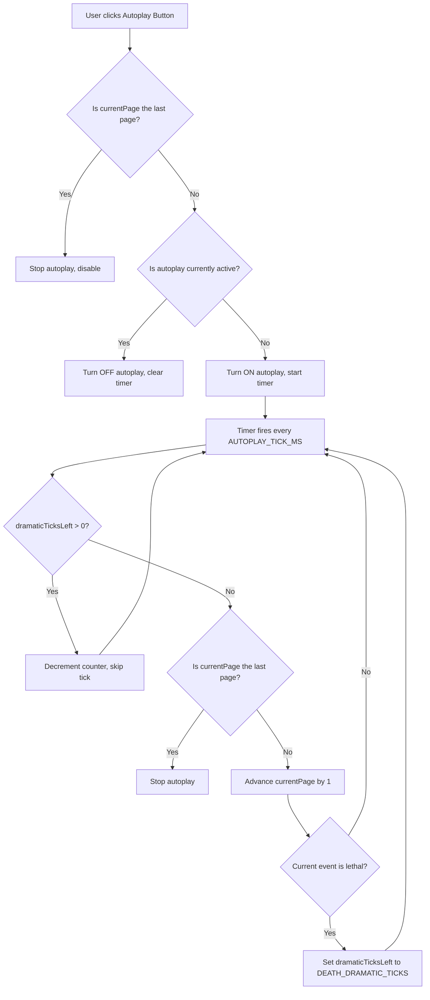

# Autoplay Feature Implementation Guide for Battle Journal

## Overview

This guide describes step-by-step how to implement an autoplay feature for the battle journal component. When activated, autoplay will automatically advance through battle events at a configurable interval, with a dramatic pause when a combatant dies.

---

## Step 1: Define Configurable Constants

At the top of [`battle-journal.ts`](GrandAutoBattler_Angular_UI/src/app/components/battle-journal/battle-journal.ts), add two `const` declarations for configurability:

```ts
// Time in milliseconds between each autoplay tick
const AUTOPLAY_TICK_MS = 500;

// Number of ticks to skip when a combatant dies (dramatic delay)
const DEATH_DRAMATIC_TICKS = 1;
```

---

## Step 2: Add Autoplay State Signals

Inside the [`BattleJournal`](GrandAutoBattler_Angular_UI/src/app/components/battle-journal/battle-journal.ts:14) class, add the following signals:

```ts
// Is autoplay currently running?
isAutoplayActive = signal(false);

// Timer reference for cleanup on destroy
private autoplayTimer: ReturnType<typeof setInterval> | null = null;

// Counter for dramatic delay (ticks remaining before next advance)
private dramaticTicksLeft = 0;
```

---

## Step 3: Implement the `toggleAutoplay` Method

Replace the existing stub method at line 121 with full logic:

```ts
toggleAutoplay() {
  // Safety: never allow autoplay on the last page
  if (this.currentPage() >= this.totalEvents() - 1) {
    this.isAutoplayActive.set(false);
    this.clearAutoplayTimer();
    return;
  }

  if (this.isAutoplayActive()) {
    // Turn OFF autoplay
    this.isAutoplayActive.set(false);
    this.clearAutoplayTimer();
  } else {
    // Turn ON autoplay
    this.isAutoplayActive.set(true);
    this.startAutoplayTimer();
  }
}
```

---

## Step 4: Implement `startAutoplayTimer` Private Method

Add this private method that starts the interval tick:

```ts
private startAutoplayTimer() {
  this.clearAutoplayTimer(); // Safety: clear any existing timer
  this.autoplayTimer = setInterval(() => {
    this.autoplayTick();
  }, AUTOPLAY_TICK_MS);
}
```

---

## Step 5: Implement `clearAutoplayTimer` Private Method

Add this private method for cleanup:

```ts
private clearAutoplayTimer() {
  if (this.autoplayTimer !== null) {
    clearInterval(this.autoplayTimer);
    this.autoplayTimer = null;
  }
}
```

---

## Step 6: Implement `autoplayTick` Private Method

This is the core logic. Each tick, check if we are in a dramatic delay, otherwise advance the page:

```ts
private autoplayTick() {
  // If we are in a dramatic delay, decrement counter and skip this tick
  if (this.dramaticTicksLeft > 0) {
    this.dramaticTicksLeft--;
    return;
  }

  // If we are already on the last page, stop autoplay
  if (this.currentPage() >= this.totalEvents() - 1) {
    this.isAutoplayActive.set(false);
    this.clearAutoplayTimer();
    return;
  }

  // Advance to next page
  this.currentPage.update((v) => v + 1);

  // Check if the new currentEvent causes a death
  if (this.isCurrentEventLethal()) {
    this.dramaticTicksLeft = DEATH_DRAMATIC_TICKS;
  }
}
```

---

## Step 7: Implement `isCurrentEventLethal` Private Method

Add helper to detect combatant death in the current event:

```ts
private isCurrentEventLethal(): boolean {
  const evt = this.currentEvent();
  if (!evt) return false;

  for (const effectEntry of evt.effects) {
    const damageEffect = effectEntry['Damage'];
    if (damageEffect && damageEffect.dst_hp_after === 0) {
      return true;
    }
  }

  return false;
}
```

---

## Step 8: Add `ngOnDestroy` Lifecycle Hook

Import `OnDestroy` from `@angular/core` and implement cleanup to prevent memory leaks:

```ts
import { Component, inject, computed, signal, OnDestroy } from '@angular/core';

export class BattleJournal implements OnDestroy {
  // ... existing code ...

  ngOnDestroy() {
    this.clearAutoplayTimer();
  }
}
```

---

## Step 9: Update the HTML Button for Visual Feedback

In [`battle-journal.html`](GrandAutoBattler_Angular_UI/src/app/components/battle-journal/battle-journal.html:95), update the autoplay button to show different icons based on state:

```html
<button (click)="toggleAutoplay()" [disabled]="currentPage() >= totalEvents()-1" title="Auto Play">
  @if (isAutoplayActive()) {
    &#9724;&#9724;  <!-- pause icon (two vertical bars) -->
  } @else {
    &#10161;       <!-- play icon (triangle) -->
  }
</button>
```

---

## Flow Diagram



---

## Summary of Changes

| File | Change |
|------|--------|
| `battle-journal.ts` | Add constants `AUTOPLAY_TICK_MS`, `DEATH_DRAMATIC_TICKS` |
| `battle-journal.ts` | Add signals `isAutoplayActive`, `autoplayTimer`, `dramaticTicksLeft` |
| `battle-journal.ts` | Implement `toggleAutoplay`, `startAutoplayTimer`, `clearAutoplayTimer`, `autoplayTick`, `isCurrentEventLethal` |
| `battle-journal.ts` | Implement `OnDestroy` for timer cleanup |
| `battle-journal.html` | Update autoplay button to show play/pause icon based on state |

---

## Edge Cases Handled

1. **User clicks autoplay on last page**: Method checks `currentPage >= totalEvents - 1` and forces autoplay off.
2. **Autoplay reaches last page during playback**: Tick checks for last page and stops automatically.
3. **Component is destroyed while autoplay is running**: `ngOnDestroy` clears the interval.
4. **Multiple rapid clicks on autoplay button**: `clearAutoplayTimer` ensures no duplicate timers.
5. **User navigates manually during autoplay**: Timer continues to run and advances alongside manual navigation.
