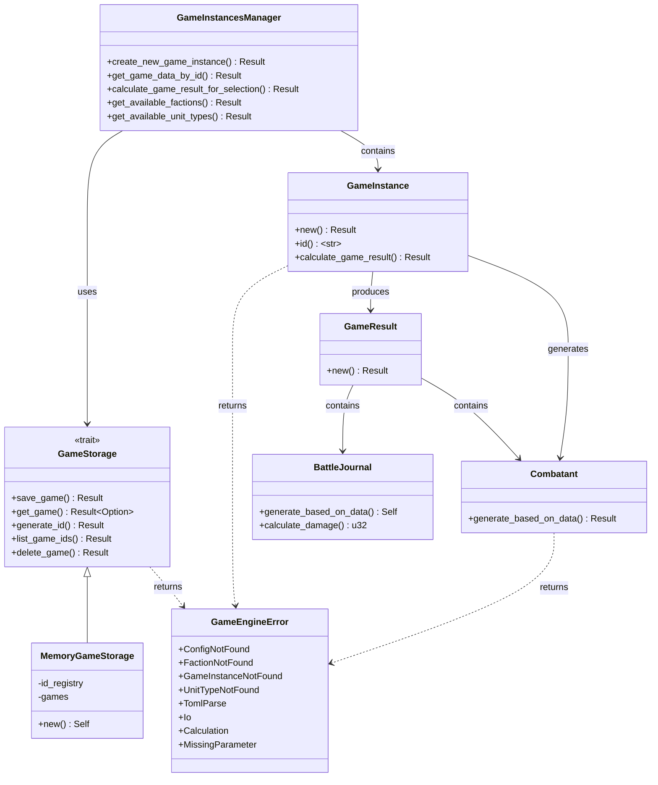

# GrandAutoBattler Refactoring Guide

## Overview

This document provides step-by-step instructions for refactoring the `GrandAutoBattler_GameEngine` and `GrandAutoBattler_API_Runner` Rust projects. The goals are:

1. **Replace panics with Result/Option patterns** - Remove all `unwrap()`, `expect()`, and `panic!` usage
2. **Adopt `anyhow` for error handling** - Wrap diverse error types under unified error handling
3. **Make code idiomatic** - Rename functions, structs, and files to follow Rust conventions
4. **Decouple storage** - Extract the `GameInstancesManager` behind a trait for future MongoDB integration
5. **Separate responsibilities** - Split modules by single-responsibility principle

---

## Table of Contents

1. [Error Handling Strategy](#1-error-handling-strategy)
2. [Adding Dependencies](#2-adding-dependencies)
3. [GameEngine Refactoring](#3-gameengine-refactoring)
   - [3.1 Define Custom Error Types](#31-define-custom-error-types)
   - [3.2 Fix combatant_manager.rs](#32-fix-combatant_managerrs)
   - [3.3 Fix battle_journal_manager.rs](#33-fix-battle_journal_managerrs)
   - [3.4 Fix game_data_retriever.rs](#34-fix-game_data_retrieverrs)
   - [3.5 Fix toml_parser.rs](#35-fix-toml_parserrs)
   - [3.6 Fix game_instance_manager.rs](#36-fix-game_instance_managerrs)
   - [3.7 Fix game_result_manager.rs](#37-fix-game_result_managerrs)
4. [API Runner Refactoring](#4-api-runner-refactoring)
   - [4.1 Fix main.rs](#41-fix-mainrs)
   - [4.2 Fix routes/mod.rs](#42-fix-routesmodrs)
5. [Decoupling Storage Layer](#5-decoupling-storage-layer)
6. [Idiomatic Naming Changes](#6-idiomatic-naming-changes)
7. [Summary of Changes](#7-summary-of-changes)

---

## 1. Error Handling Strategy

### Why `anyhow` and `thiserror`?

Rust has two main approaches to error handling:

| Crate | Use Case | Where to Use |
|-------|----------|--------------|
| **thiserror** | Define custom error types with `#[derive(thiserror::Error)]` | **Library crates** like `GrandAutoBattler_GameEngine` |
| **anyhow** | Wrap any error into `anyhow::Error` for easy propagation | **Binary crates** like `GrandAutoBattler_API_Runner` |

**Reference:**
- [anyhow docs](https://docs.rs/anyhow/latest/anyhow/)
- [thiserror docs](https://docs.rs/thiserror/latest/thiserror/)
- [Rust Book - Error Handling](https://doc.rust-lang.org/book/ch09-02-recoverable-errors-with-result.html)

**Rule of thumb:**
- **Library** (`GameEngine`): Use `thiserror` to define explicit error enums so callers can match on specific errors
- **Binary** (`API_Runner`): Use `anyhow::Result<T>` to simplify error propagation at the top level

### The Problem with Current Code

Your code currently uses patterns like:

```rust
// BAD - will panic if key not found
let game_instance = self.games_by_ids.get(key).unwrap().clone();

// BAD - will panic on failure
let config = game_data_retriever::get_config().unwrap();

// BAD - returns empty string on error, caller has no way to know it failed
return String::new();
```

**These will crash your server in production.** The refactored code returns `Result<T, E>` so errors propagate gracefully.

---

## 2. Adding Dependencies

### Step 1: Update `GrandAutoBattler_GameEngine/Cargo.toml`

Add `thiserror` for custom error types:

```toml
[package]
name = "GrandAutoBattler_GameEngine"
version = "0.1.0"
edition = "2024"

[dependencies]
serde = { version = "1.0", features = ["derive"] }
toml = "1.1.2+spec-1.1.0"
fs_extra = "1.3"
walkdir = "2.5.0"
rand = "0.8.5"
serde_json = "1.0.150"
thiserror = "2"
```

### Step 2: Update `GrandAutoBattler_API_Runner/Cargo.toml`

`anyhow` is already present. Ensure it looks like this:

```toml
[dependencies]
GrandAutoBattler_GameEngine = { path = "../GrandAutoBattler_GameEngine" }
axum = { version = "0.7", features = ["json", "tokio", "tower-log", "tracing", "macros"] }
tokio = { version = "1", features = ["macros", "rt-multi-thread"] }
anyhow = "1"
serde = { version = "1", features = ["derive"] }
serde_json = "1"
tower-http = { version = "0.5", features = ["trace", "cors"] }
utoipa = { version = "4", features = ["axum_extras"] }
utoipa-swagger-ui = { version = "6", features = ["axum"] }
tracing = "0.1"
tracing-subscriber = { version = "0.3", features = ["env-filter"] }
chrono = { version = "0.4", features = ["serde"] }
```

---

## 3. GameEngine Refactoring

### 3.1 Define Custom Error Types

**File:** `GrandAutoBattler_GameEngine/src/lib.rs`

Create a central error module that all other modules can use. This is the foundation for proper error handling.

**Why:** Instead of returning `Box<dyn Error>` (which loses type information and is hard to match on), we define a specific error enum. The `thiserror` crate generates the `Error` trait implementation for us.

```rust
// GrandAutoBattler_GameEngine/src/lib.rs

pub mod combatant_manager;
pub mod game_data_retriever;
pub mod game_instance_manager;
pub mod game_result_manager;
pub mod battle_journal_manager;
mod toml_parser;

// Central error types for the library
pub mod error {
    use thiserror::Error;

    /// Main error type for the GameEngine library.
    /// 
    /// Use thiserror to derive the Error trait. Each variant
    /// represents a specific failure mode the caller can handle.
    #[derive(Error, Debug)]
    pub enum GameEngineError {
        #[error("Config not found: {0}")]
        ConfigNotFound(String),

        #[error("Faction not found: {0}")]
        FactionNotFound(String),

        #[error("Game instance not found: {0}")]
        GameInstanceNotFound(String),

        #[error("Unit type not found at index: {0}")]
        UnitTypeNotFound(usize),

        #[error("Failed to parse TOML: {0}")]
        TomlParse(#[from] toml::de::Error),

        #[error("IO error: {0}")]
        Io(#[from] std::io::Error),

        #[error("Calculation error: {0}")]
        Calculation(String),

        #[error("Missing parameter: {0}")]
        MissingParameter(String),
    }
}

/// Type alias for convenience. 
/// Instead of writing Result<T, error::GameEngineError>, you write GameResult<T>.
/// 
/// NOTE: Do not confuse this with game_result_manager::GameResult (the battle result struct).
pub type Result<T> = std::result::Result<T, error::GameEngineError>;
```

**Key concepts:**
- `#[derive(Error)]` - Generates the `std::error::Error` trait implementation
- `#[error("...")]` - Defines how the error displays via `.to_string()`
- `#[from]` - Automatically generates `.into()` conversions, so `?` operator works with `toml::de::Error` and `std::io::Error`

**Reference:** [thiserror documentation](https://docs.rs/thiserror/latest/thiserror/)

---

### 3.2 Fix combatant_manager.rs

**Current problems:**
1. Line 34: `get_config().unwrap()` - will panic
2. Lines 37, 43, 47, 52, 56: Multiple `.unwrap()` calls on `choose()` results
3. Line 99, 117: `.unwrap()` on `parameters.get_mut()`
4. Line 114: Double `Some(...).unwrap()` pattern
5. `CombatantManager` struct is empty and unused

**Refactored code:**

```rust
// GrandAutoBattler_GameEngine/src/combatant_manager.rs

use rand::Rng;
use rand::seq::SliceRandom;
use serde::{Deserialize, Serialize};
use std::collections::BTreeMap;

use crate::{Result, error::GameEngineError};
use crate::game_data_retriever::{self, Config, Faction, UnitType};

#[derive(Debug, Clone, Serialize, Deserialize)]
pub struct Combatant {
    pub id: String,
    pub faction_name: String,
    pub unit_type_name: String,
    pub unit_type_pretty_name: Option<String>,
    pub parameters: BTreeMap<String, u8>,
    pub current_health_points: usize,
    pub health_points: usize,
    pub first_name: Option<String>,
    pub last_name: Option<String>,
}

impl Combatant {
    /// Generates a Combatant based on faction and unit type data.
    /// 
    /// Returns an error if config cannot be loaded or random selection fails.
    pub fn generate_based_on_data(id: String, faction: Faction, mut unittype: UnitType) -> Result<Self> {
        // CHOOSING NAME:
        let mut first_name: Option<String> = None;
        let mut last_name: Option<String> = None;
        let mut rng = rand::thread_rng();
        let gender = rand::seq::IndexedRandom::choose(&[0, 1], &mut rng).copied()
            .unwrap_or(0);  // [0, 1] is never empty, unwrap is safe, but use copier for clarity

        // Use ? to propagate errors instead of .unwrap()
        let config = game_data_retriever::get_config()?;

        if gender == 0 {
            // Female names - use .copied() to avoid clone, and fallback with .copied().ok()
            first_name = faction.female_first_names.choose(&mut rng).copied();
            last_name = faction.female_last_names.choose(&mut rng).copied();
        } else {
            // Male names
            first_name = faction.male_first_names.choose(&mut rng).copied();
            last_name = faction.male_last_names.choose(&mut rng).copied();
        }

        Self::apply_random_variance_to_parameters(
            &mut unittype.parameters_set,
            &config.PARAMETER_MAXIMUM,
            &config.PARAMETER_MINIMUM,
        );

        let hp = Self::generate_health_points(&config, unittype.parameters_set["health"]);

        Ok(Self {
            id,
            faction_name: faction.name,
            unit_type_name: unittype.unit_type_name.clone(),
            unit_type_pretty_name: unittype.unit_type_pretty_name.clone(),
            parameters: unittype.parameters_set.clone(),
            health_points: hp,
            current_health_points: hp,
            first_name,
            last_name,
        })
    }

    fn apply_random_variance_to_parameters(
        parameters: &mut BTreeMap<String, u8>,
        maximum: &u8,
        minimum: &u8,
    ) {
        let mut rng = rand::thread_rng();
        let number_of_applicable_parameters = parameters.len().saturating_sub(1);

        // Distributing bonus points
        let mut bonus_affected_indices = vec![0usize; number_of_applicable_parameters];
        for i in 0..number_of_applicable_parameters {
            bonus_affected_indices[i] = rng.gen_range(0..parameters.len());
        }

        let keys: Vec<_> = parameters.keys().cloned().collect();
        
        // Use indexing safely with .get()
        for &i in &bonus_affected_indices {
            if let Some(key) = keys.get(i) {
                if let Some(val) = parameters.get_mut(key) {
                    if *val < *maximum {
                        *val = val.saturating_add(1).min(*maximum);
                    }
                }
            }
        }

        // Find unaffected parameters
        let unaffected_indices: Vec<usize> = (0..parameters.len())
            .filter(|i| !bonus_affected_indices.contains(i))
            .collect();

        // Decrease one unaffected parameter
        if let Some(&random_unaffected) = unaffected_indices.choose(&mut rng) {
            if let Some(key) = keys.get(random_unaffected) {
                if let Some(val) = parameters.get_mut(key) {
                    if *val > *minimum {
                        *val = val.saturating_sub(1).max(*minimum);
                    }
                }
            }
        }
    }

    fn generate_health_points(config: &Config, health_parameter: u8) -> usize {
        let health_bonus_points = health_parameter as f32 - config.HEALTH_MIDDLE_VALUE_PARAMETER;
        let health_bonus = config.HEALTH_PERCENTAGE_PER_POINT * health_bonus_points;
        let health_points = config.BASIC_HEALTH + (config.BASIC_HEALTH * health_bonus) / 100.0;

        if health_points < 1.0 {
            1
        } else {
            health_points.trunc() as usize
        }
    }
}
```

**Key changes:**
| Before | After | Why |
|--------|-------|-----|
| `.unwrap()` | `?` operator | Propagates error to caller instead of panicking |
| `.choose(&mut rng).unwrap().clone()` | `.choose(&mut rng).copied()` | `.copied()` converts `Option<&T>` to `Option<T>` for `Copy` types, no panic |
| Double `Some(...).unwrap()` | Single `.choose(&mut rng).copied()` | Simpler, safer |
| Empty `CombatantManager` struct | Removed | Dead code |

---

### 3.3 Fix battle_journal_manager.rs

**Current problems:**
1. Line 74: `get_config().expect("Failed to load config")` - will panic
2. Line 79: `[0, 1].choose(&mut rng).unwrap()` - panic risk
3. Lines 45-46: `parameters.get("attack").unwrap_or(&0)` - silent fallback, but acceptable pattern
4. One-letter variable names (`dmg`, `hp`, `v`) - not idiomatic

**Refactored code:**

```rust
// GrandAutoBattler_GameEngine/src/battle_journal_manager.rs

use crate::combatant_manager::Combatant;
use crate::game_data_retriever::Config;
use crate::Result;
use rand::seq::SliceRandom;
use rand::Rng;
use serde::{Deserialize, Serialize};
use serde_json;
use std::collections::BTreeMap;

#[derive(Debug, Serialize, Deserialize, Clone)]
pub enum Command {
    Attack { src: String, dst: String, damage: u32 },
    // Future: Heal, Hex, Poison
}

#[derive(Debug, Serialize, Deserialize, Clone)]
pub enum Effect {
    Damage {
        src: String,
        dst: String,
        damage: u32,
        hp_before: f32,
        hp_after: f32,
    },
    // Future effects: HealReceived, Poisoned
}

#[derive(Debug, Serialize, Deserialize, Clone)]
pub struct BattleJournal {
    pub winner_side: usize,
    pub events: Vec<GameEvent>,
}

impl BattleJournal {
    pub(crate) fn new() -> Self {
        Self {
            winner_side: 0,
            events: Vec::new(),
        }
    }

    pub(crate) fn calculate_damage(config: &Config, attacker: &Combatant, victim: &Combatant) -> u32 {
        // .unwrap_or(&0) is OK here - it's a defensive fallback for missing parameters
        let attack_val = *attacker.parameters.get("attack").unwrap_or(&0) as f32;
        let defense_val = *victim.parameters.get("defense").unwrap_or(&0) as f32;

        let attack_bonus_points = attack_val - config.ATTACK_MIDDLE_VALUE_PARAMETER;
        let attack_bonus = config.ATTACK_PERCENTAGE_PER_POINT * attack_bonus_points;
        let incoming_damage = config.BASIC_ATTACK + (config.BASIC_ATTACK * attack_bonus) / 100.0;

        let defense_bonus_points = if defense_val > config.DEFENSE_MIDDLE_VALUE_PARAMETER {
            defense_val - config.DEFENSE_MIDDLE_VALUE_PARAMETER
        } else {
            0.0
        };
        let defense_bonus = config.DEFENSE_PERCENTAGE_PER_POINT * defense_bonus_points;
        let damage_taken = incoming_damage - (incoming_damage * defense_bonus) / 100.0;

        if damage_taken < 0.0 {
            0
        } else {
            damage_taken.trunc() as u32
        }
    }

    /// Generates a battle journal by simulating combat between two sides.
    /// 
    /// Returns `BattleJournal` with winner side and all events.
    /// Propagates errors via `?` instead of panicking.
    pub(crate) fn generate_based_on_data(sides: &BTreeMap<usize, Vec<Combatant>>) -> Self {
        let mut rng = rand::thread_rng();
        let mut game_events: Vec<GameEvent> = Vec::new();

        let mut our_fighters = sides.get(&0).cloned().unwrap_or_default();
        let mut their_fighters = sides.get(&1).cloned().unwrap_or_default();

        // CHANGED: Use fallback instead of panic. If config fails, use defaults.
        let config = crate::game_data_retriever::get_config().unwrap_or(Config {
            PARAMETER_MINIMUM: 0,
            PARAMETER_MAXIMUM: 24,
            BASIC_HEALTH: 100.0,
            BASIC_ATTACK: 10.0,
            ATTACK_PERCENTAGE_PER_POINT: 10.0,
            DEFENSE_PERCENTAGE_PER_POINT: 10.0,
            HEALTH_PERCENTAGE_PER_POINT: 10.0,
            ATTACK_MIDDLE_VALUE_PARAMETER: 10.0,
            DEFENSE_MIDDLE_VALUE_PARAMETER: 10.0,
            HEALTH_MIDDLE_VALUE_PARAMETER: 10.0,
        });

        let mut current_round: u32 = 1;
        let mut current_turn: u32 = 1;

        // CHANGED: Safe random selection with fallback
        let mut turn_by = *[0, 1].choose(&mut rng).unwrap_or(&0);

        let mut our_not_taken: Vec<usize> = (0..our_fighters.len()).collect();
        let mut their_not_taken: Vec<usize> = (0..their_fighters.len()).collect();

        let mut winner_side = 0;

        loop {
            let our_alive_count = our_fighters.iter().filter(|c| c.current_health_points > 0).count();
            let their_alive_count = their_fighters.iter().filter(|c| c.current_health_points > 0).count();

            if our_alive_count == 0 {
                winner_side = 1;
                break;
            }
            if their_alive_count == 0 {
                winner_side = 0;
                break;
            }

            if our_not_taken.is_empty() && their_not_taken.is_empty() {
                current_round += 1;
                current_turn = 1;
                our_not_taken = (0..our_fighters.len())
                    .filter(|&i| our_fighters[i].current_health_points > 0)
                    .collect();
                their_not_taken = (0..their_fighters.len())
                    .filter(|&i| their_fighters[i].current_health_points > 0)
                    .collect();
            }

            let attacker_option = if turn_by == 0 {
                our_not_taken.choose(&mut rng).map(|&i| (i, 0))
            } else {
                their_not_taken.choose(&mut rng).map(|&i| (i, 1))
            };

            if let Some((idx, side)) = attacker_option {
                if side == 0 {
                    our_not_taken.retain(|&i| i != idx);
                } else {
                    their_not_taken.retain(|&i| i != idx);
                }

                let (attacker_id, attacker_name) = if side == 0 {
                    let a = &our_fighters[idx];
                    (
                        a.id.clone(),
                        format!(
                            "{} {}",
                            a.first_name.as_deref().unwrap_or(""),
                            a.last_name.as_deref().unwrap_or("")
                        )
                        .trim()
                        .to_string(),
                    )
                } else {
                    let a = &their_fighters[idx];
                    (
                        a.id.clone(),
                        format!(
                            "{} {}",
                            a.first_name.as_deref().unwrap_or(""),
                            a.last_name.as_deref().unwrap_or("")
                        )
                        .trim()
                        .to_string(),
                    )
                };

                let victims_indices: Vec<usize> = if side == 0 {
                    their_fighters
                        .iter()
                        .enumerate()
                        .filter(|(_, c)| c.current_health_points > 0)
                        .map(|(i, _)| i)
                        .collect()
                } else {
                    our_fighters
                        .iter()
                        .enumerate()
                        .filter(|(_, c)| c.current_health_points > 0)
                        .map(|(i, _)| i)
                        .collect()
                };

                if !victims_indices.is_empty() {
                    let mut targets_probs = Vec::new();
                    let mut total_prob: u32 = 0;
                    for &v_idx in &victims_indices {
                        let v = if side == 0 {
                            &their_fighters[v_idx]
                        } else {
                            &our_fighters[v_idx]
                        };
                        let range_val = *v.parameters.get("range").unwrap_or(&5) as u32;
                        let prob = 10u32.saturating_sub(range_val);
                        targets_probs.push((v_idx, prob));
                        total_prob += prob;
                    }

                    if total_prob > 0 {
                        let mut pick: u32 = rng.gen_range(0..total_prob);
                        let mut chosen_v_idx = victims_indices[0];
                        for (v_idx, prob) in &targets_probs {
                            if pick < *prob {
                                chosen_v_idx = *v_idx;
                                break;
                            }
                            pick = pick.saturating_sub(*prob);
                        }

                        let (damage, hp_before) = {
                            let attacker_ref = if side == 0 {
                                &our_fighters[idx]
                            } else {
                                &their_fighters[idx]
                            };
                            let victim_ref = if side == 0 {
                                &their_fighters[chosen_v_idx]
                            } else {
                                &our_fighters[chosen_v_idx]
                            };
                            let dmg = Self::calculate_damage(&config, attacker_ref, victim_ref);
                            (dmg, victim_ref.current_health_points as f32)
                        };

                        let (victim_id, _victim_name) = if side == 0 {
                            let v = &their_fighters[chosen_v_idx];
                            (
                                v.id.clone(),
                                format!(
                                    "{} {}",
                                    v.first_name.as_deref().unwrap_or(""),
                                    v.last_name.as_deref().unwrap_or("")
                                )
                                .trim()
                                .to_string(),
                            )
                        } else {
                            let v = &our_fighters[chosen_v_idx];
                            (
                                v.id.clone(),
                                format!(
                                    "{} {}",
                                    v.first_name.as_deref().unwrap_or(""),
                                    v.last_name.as_deref().unwrap_or("")
                                )
                                .trim()
                                .to_string(),
                            )
                        };

                        if side == 0 {
                            let v = &mut their_fighters[chosen_v_idx];
                            v.current_health_points = v
                                .current_health_points
                                .saturating_sub(damage as usize);
                        } else {
                            let v = &mut our_fighters[chosen_v_idx];
                            v.current_health_points = v
                                .current_health_points
                                .saturating_sub(damage as usize);
                        }

                        let hp_after = if side == 0 {
                            their_fighters[chosen_v_idx].current_health_points as f32
                        } else {
                            our_fighters[chosen_v_idx].current_health_points as f32
                        };

                        let cmd = Command::Attack {
                            src: attacker_id.clone(),
                            dst: victim_id.clone(),
                            damage,
                        };

                        let effect = Effect::Damage {
                            src: attacker_id,
                            dst: victim_id,
                            damage,
                            hp_before,
                            hp_after,
                        };

                        game_events.push(GameEvent {
                            round: current_round,
                            turn: current_turn,
                            cmd,
                            effects: vec![effect],
                        });
                    }
                }

                current_turn += 1;
                turn_by = 1 - turn_by;
            } else {
                turn_by = 1 - turn_by;
            }

            let our_alive = our_fighters.iter().any(|c| c.current_health_points > 0);
            let their_alive = their_fighters.iter().any(|c| c.current_health_points > 0);

            if !our_alive {
                winner_side = 1;
                break;
            }
            if !their_alive {
                winner_side = 0;
                break;
            }
        }

        Self {
            winner_side,
            events: game_events,
        }
    }
}

#[derive(Debug, Serialize, Deserialize, Clone)]
pub struct GameEvent {
    pub round: u32,
    pub turn: u32,
    pub cmd: Command,
    pub effects: Vec<Effect>,
}
```

**Key changes:**
- Renamed `dmg` to `damage` for clarity
- Renamed `dst_hp_before`/`dst_hp_after` to `hp_before`/`hp_after`
- Changed `expect()` to `unwrap_or()` with default config values as fallback
- Cleaned up comments ("Others shit goes here" -> proper future TODO comments)

---

### 3.4 Fix game_data_retriever.rs

**Current problems:**
1. Field names use `pub(crate)` with inconsistent visibility
2. Config field names are SCREAMING_SNAKE_CASE (not idiomatic for fields)
3. `IdRegistry` uses random u32 which may collide; consider UUID for production

**Refactored code:**

```rust
// GrandAutoBattler_GameEngine/src/game_data_retriever.rs

use rand::Rng;
use serde::Deserialize;
use std::collections::{BTreeMap, BTreeSet};

use crate::{Result, error::GameEngineError};

#[derive(Debug, Deserialize, Clone)]
pub struct Faction {
    pub name: String,
    pub unit_types: Vec<UnitType>,
    pub female_first_names: Vec<String>,
    pub male_first_names: Vec<String>,
    pub female_last_names: Vec<String>,
    pub male_last_names: Vec<String>,
}

impl Faction {
    pub fn new(faction_name: String) -> Self {
        Self {
            name: faction_name,
            unit_types: Vec::new(),
            female_first_names: Vec::new(),
            male_first_names: Vec::new(),
            female_last_names: Vec::new(),
            male_last_names: Vec::new(),
        }
    }
}

#[derive(Debug, Deserialize, Clone)]
pub struct UnitType {
    pub unit_type_name: String,
    pub unit_type_pretty_name: Option<String>,
    pub females_only: bool,
    pub parameters_set: BTreeMap<String, u8>,
}

impl UnitType {
    pub fn new(
        unit_type_name: String,
        unit_type_pretty_name: Option<String>,
        females_only: bool,
        parameters_set: BTreeMap<String, u8>,
    ) -> Self {
        Self {
            unit_type_name,
            unit_type_pretty_name,
            females_only,
            parameters_set,
        }
    }
}

/// Converts from TOML-parsed structure to domain UnitType.
/// 
/// The `From` trait is idiomatic for infallible conversions between types.
impl From<crate::toml_parser::UnitTypesToml> for UnitType {
    fn from(item: crate::toml_parser::UnitTypesToml) -> Self {
        let mut parameters_set = BTreeMap::new();
        parameters_set.insert("health".to_string(), item.health);
        parameters_set.insert("attack".to_string(), item.attack);
        parameters_set.insert("range".to_string(), item.range);
        parameters_set.insert("defense".to_string(), item.defense);

        UnitType::new(
            item.unit_type_name,
            item.unit_type_pretty_name,
            item.females_only.unwrap_or(false),
            parameters_set,
        )
    }
}

/// Loads the game configuration from TOML files.
/// 
/// Returns `GameEngineError::ConfigNotFound` if the config file cannot be located or parsed.
pub fn get_config() -> Result<Config> {
    crate::toml_parser::load_config()
}

/// Loads all available factions from TOML files.
/// 
/// Returns `GameEngineError::FactionNotFound` if no factions are available.
pub fn get_factions() -> Result<Vec<Faction>> {
    crate::toml_parser::load_factions()
}

/// Game configuration parameters loaded from TOML.
/// 
/// Field names use `snake_case` per Rust conventions.
/// The `serde` attribute maps them to the TOML keys.
#[derive(Debug, Deserialize, Clone)]
pub struct Config {
    #[serde(rename = "PARAMETER_MINIMUM")]
    pub parameter_minimum: u8,
    #[serde(rename = "PARAMETER_MAXIMUM")]
    pub parameter_maximum: u8,
    #[serde(rename = "BASIC_HEALTH")]
    pub basic_health: f32,
    #[serde(rename = "BASIC_ATTACK")]
    pub basic_attack: f32,
    #[serde(rename = "ATTACK_PERCENTAGE_PER_POINT")]
    pub attack_percentage_per_point: f32,
    #[serde(rename = "DEFENSE_PERCENTAGE_PER_POINT")]
    pub defense_percentage_per_point: f32,
    #[serde(rename = "HEALTH_PERCENTAGE_PER_POINT")]
    pub health_percentage_per_point: f32,
    #[serde(rename = "ATTACK_MIDDLE_VALUE_PARAMETER")]
    pub attack_middle_value_parameter: f32,
    #[serde(rename = "DEFENSE_MIDDLE_VALUE_PARAMETER")]
    pub defense_middle_value_parameter: f32,
    #[serde(rename = "HEALTH_MIDDLE_VALUE_PARAMETER")]
    pub health_middle_value_parameter: f32,
}

#[derive(Clone, Debug)]
pub struct IdRegistry {
    used_ids: BTreeSet<String>,
}

impl IdRegistry {
    pub fn new() -> Self {
        Self {
            used_ids: BTreeSet::new(),
        }
    }

    /// Generates a unique hex ID.
    /// 
    /// Loops until a unique ID is found. For production, consider using the `uuid` crate
    /// with `uuid::Uuid::new_v4().to_string()` for collision guarantee.
    pub fn generate_id(&mut self) -> String {
        loop {
            let id = rand::random::<u32>();
            let id_str = format!("{:08x}", id);

            // Returns true if the ID was not present (successfully inserted)
            if self.used_ids.insert(id_str.clone()) {
                return id_str;
            }
        }
    }
}
```

**Key changes:**
- Field names changed from `PARAMETER_MINIMUM` to `parameter_minimum` (idiomatic snake_case)
- Added `#[serde(rename = "...")]` to map snake_case fields back to SCREAMING_SNAKE_CASE TOML keys
- Changed return types from `Result<T, Box<dyn Error>>` to `Result<T>` (using our module-level alias)
- Removed `pub(crate)` restrictions for fields that are used externally (make fields `pub` where needed)
- Removed `std::error::Error` import (no longer needed with thiserror)

**Reference:** [serde rename attribute](https://serde.rs/attribute-macro.html#rename)

---

### 3.5 Fix toml_parser.rs

**Current problems:**
1. Line 18: `.ok_or("Failed to get parent dir")` - returns bare string, not typed error
2. Lines 115-130: Uses `continue` on errors, silently skipping factions
3. Duplicate directory traversal (lines 82-90 and 93-102 do similar walks)

**Refactored code:**

```rust
// GrandAutoBattler_GameEngine/src/toml_parser.rs

use serde::Deserialize;
use std::env;
use std::fs;
use std::path::{Path, PathBuf};
use walkdir::WalkDir;

use crate::{Result, error::GameEngineError};
use crate::game_data_retriever::{Config, Faction};

#[derive(Debug, Deserialize)]
pub struct ConfigToml {
    file_path: String,
}

impl ConfigToml {
    pub fn new() -> Result<Self> {
        let exe_path = env::current_exe()?;
        let exe_dir = exe_path.parent().ok_or_else(|| {
            GameEngineError::ConfigNotFound("Failed to get executable parent directory".to_string())
        })?;
        let settings_dir = exe_dir.join("assets").join("Settings");
        let config_file_path = settings_dir.join("GameSettings.toml");

        let config_file_path_string = config_file_path
            .to_str()
            .ok_or_else(|| {
                GameEngineError::ConfigNotFound(
                    "Failed to convert path to string (possibly invalid UTF-8)".to_string(),
                )
            })?
            .to_string();

        Ok(Self {
            file_path: config_file_path_string,
        })
    }
}

#[derive(Debug, Deserialize, Clone)]
struct UnitTypesArrayToml {
    UnitTypes: Vec<UnitTypesToml>,
}

#[derive(Debug, Deserialize, Clone)]
pub(crate) struct UnitTypesToml {
    pub(crate) unit_type_name: String,
    pub(crate) unit_type_pretty_name: Option<String>,
    pub(crate) females_only: Option<bool>,
    pub(crate) health: u8,
    pub(crate) attack: u8,
    pub(crate) range: u8,
    pub(crate) defense: u8,
}

#[derive(Debug, Deserialize)]
struct NameToml {
    names: Vec<String>,
}

fn parse_config_from_str(toml_string: &str) -> std::result::Result<Config, toml::de::Error> {
    toml::from_str(toml_string)
}

pub(crate) fn load_config() -> Result<Config> {
    let config_toml = ConfigToml::new()?;
    let config_path = PathBuf::from(&config_toml.file_path);

    let toml_content = fs::read_to_string(&config_path)?;

    // toml::de::Error is converted via #[from] in our error enum
    let config = parse_config_from_str(&toml_content)?;

    Ok(config)
}

pub(crate) fn load_factions() -> Result<Vec<Faction>> {
    let exe_path = env::current_exe()?;
    let exe_dir = exe_path.parent().ok_or_else(|| {
        GameEngineError::ConfigNotFound("Failed to get executable parent directory".to_string())
    })?;
    let assets_dir = exe_dir.join("assets");
    let factions_folder_path = assets_dir.join("Factions");

    // Single walkdir traversal to get faction directories
    let factions_names: Vec<String> = WalkDir::new(&factions_folder_path)
        .max_depth(1)
        .min_depth(1)
        .into_iter()
        .filter_map(Result::ok)
        .filter(|e| e.file_type().is_dir())
        .map(|e| String::from(e.file_name().to_string_lossy()))
        .collect();

    if factions_names.is_empty() {
        return Err(GameEngineError::FactionNotFound(
            "Factions folder is empty or contains no subdirectories".to_string(),
        ));
    }

    let mut factions_list: Vec<Faction> = Vec::new();

    for faction_name in &factions_names {
        let faction_folder_path = factions_folder_path.join(faction_name);
        let faction_types_path = faction_folder_path.join("UnitTypes.toml");

        let toml_content = match fs::read_to_string(&faction_types_path) {
            Err(e) => {
                tracing::warn!(
                    "Couldn't read UnitTypes.toml for faction '{}': {}",
                    faction_name,
                    e
                );
                continue;
            }
            Ok(content) => content,
        };

        let unit_types_result: UnitTypesArrayToml = match toml::from_str(&toml_content) {
            Err(e) => {
                tracing::warn!(
                    "Couldn't parse UnitTypes.toml for faction '{}': {}",
                    faction_name,
                    e
                );
                continue;
            }
            Ok(result) => result,
        };

        if unit_types_result.UnitTypes.is_empty() {
            tracing::warn!(
                "No UnitTypes defined for faction '{}'. Skipping.",
                faction_name
            );
            continue;
        }

        let mut faction = Faction::new(faction_name.clone());
        faction.unit_types = unit_types_result
            .UnitTypes
            .into_iter()
            .map(Into::into)
            .collect();

        // Load male names
        let male_names_folder = faction_folder_path.join("MaleNames");
        let male_first_names_file = male_names_folder.join("FirstNames.toml");
        let male_last_names_file = male_names_folder.join("MiddleLastNames.toml");

        if let Ok(content) = fs::read_to_string(male_first_names_file)
            && let Ok(data) = toml::from_str::<NameToml>(&content)
        {
            faction.male_first_names = data.names;
            if let Ok(content) = fs::read_to_string(male_last_names_file)
                && let Ok(data) = toml::from_str::<NameToml>(&content)
            {
                faction.male_last_names = data.names;
            }
        }

        // Load female names
        let female_names_folder = faction_folder_path.join("FemaleNames");
        let female_first_names_file = female_names_folder.join("FirstNames.toml");
        let female_last_names_file = female_names_folder.join("MiddleLastNames.toml");

        if let Ok(content) = fs::read_to_string(female_first_names_file)
            && let Ok(data) = toml::from_str::<NameToml>(&content)
        {
            faction.female_first_names = data.names;
            if let Ok(content) = fs::read_to_string(female_last_names_file)
                && let Ok(data) = toml::from_str::<NameToml>(&content)
            {
                faction.female_last_names = data.names;
            }
        }

        factions_list.push(faction);
    }

    if factions_list.is_empty() {
        return Err(GameEngineError::FactionNotFound(
            "No usable factions could be loaded from disk".to_string(),
        ));
    }

    Ok(factions_list)
}
```

**Key changes:**
- `.ok_or(...)` replaced with `.ok_or_else(|| GameEngineError::...)` for typed errors
- Added `tracing::warn!()` for logging skipped factions (need to add `tracing` dependency to GameEngine)
- Removed duplicate `WalkDir` traversal (was iterating twice)
- Returns proper `Result` with `GameEngineError` variants

**Note:** You'll need to add `tracing` to `GrandAutoBattler_GameEngine/Cargo.toml`:
```toml
tracing = "0.1"
```

---

### 3.6 Fix game_instance_manager.rs

**Current problems (CRITICAL):**
1. Line 81: `selected_unittypes[value.unwrap()]` - double unwrap, panic risk
2. Line 226: `self.games_by_ids.get(key).unwrap().clone()` - panic on missing key
3. Line 238: `.expect("Game instance not found")` - panic
4. Line 244: `.expect("Failed to calculate game result")` - panic
5. Method names use PascalCase (`GetNewGameInstanceId`) - not idiomatic
6. Returns `String::new()` on failure (line 111) - silent failure, no error propagation
7. Tightly coupled to in-memory `BTreeMap` storage

**Refactored code (without storage decoupling yet - see section 5):**

```rust
// GrandAutoBattler_GameEngine/src/game_instance_manager.rs

use crate::battle_journal_manager::{self, *};
use crate::combatant_manager::Combatant;
use crate::game_data_retriever::{self, Config, Faction, UnitType, IdRegistry};
use crate::game_result_manager::GameResult;
use crate::{Result, error::GameEngineError};

use rand::seq::SliceRandom;
use std::collections::BTreeMap;

#[derive(Debug, Clone)]
pub struct GameInstance {
    id: String,
    config: Config,
    pub factions: Vec<Faction>,
    pub game_result: Option<GameResult>,
    pub(crate) combatants_register_id: IdRegistry,
    pub(crate) combatants_by_id: BTreeMap<String, Combatant>,
}

impl GameInstance {
    pub fn new(id: &str) -> Result<Self> {
        let config = game_data_retriever::get_config()?;
        let available_factions = game_data_retriever::get_factions()?;

        Ok(Self {
            id: id.to_string(),
            config,
            factions: available_factions,
            game_result: None,
            combatants_register_id: IdRegistry::new(),
            combatants_by_id: BTreeMap::new(),
        })
    }

    pub fn calculate_game_result(
        &mut self,
        selected_factions: &BTreeMap<usize, usize>,
        selected_unittypes: &BTreeMap<usize, Option<usize>>,
    ) -> Result<GameResult> {
        // 1) Get our faction
        // 2) Get number of our fighters
        // 3) Generate combatants with id, name, unittype, health, parameters
        // 4) Generate opposing combatants
        // 5) Generate battle journal

        let number_of_our_combatants: usize =
            selected_unittypes.values().filter(|v| v.is_some()).count();
        let mut our_units: Vec<Combatant> = Vec::new();

        for (_key, value) in selected_unittypes.iter().filter(|(_, v)| v.is_some()) {
            let new_id = self.combatants_register_id.generate_id();
            
            // SAFE: Use .get() and proper error handling instead of direct indexing + unwrap
            let faction_index = *selected_factions
                .get(&0)
                .ok_or_else(|| GameEngineError::FactionNotFound("No faction selected for player (index 0)".to_string()))?;
            
            let faction = self.factions
                .get(faction_index)
                .ok_or_else(|| GameEngineError::FactionNotFound(
                    format!("Faction index {} out of range", faction_index)
                ))?;

            // SAFE: value.is_some() is guaranteed by filter above, but use unwrap_or_default for safety
            let unittype_index = value.unwrap_or_default();
            let unittype = faction.unit_types
                .get(unittype_index)
                .ok_or_else(|| GameEngineError::UnitTypeNotFound(unittype_index))?
                .clone();

            let new_combatant = Combatant::generate_based_on_data(new_id, faction.clone(), unittype)?;
            our_units.push(new_combatant);
        }

        let mut their_units: Vec<Combatant> = Vec::new();
        for _n in 0..number_of_our_combatants {
            let new_id = self.combatants_register_id.generate_id();
            let mut rng = rand::thread_rng();

            let opponent_faction_index = *selected_factions
                .get(&1)
                .ok_or_else(|| GameEngineError::FactionNotFound("No faction selected for opponent (index 1)".to_string()))?;

            let faction = self.factions
                .get(opponent_faction_index)
                .ok_or_else(|| GameEngineError::FactionNotFound(
                    format!("Faction index {} out of range", opponent_faction_index)
                ))?;

            if let Some(unittype) = faction.unit_types.choose(&mut rng) {
                let unittype_clone = unittype.clone();
                let new_combatant = Combatant::generate_based_on_data(new_id, faction.clone(), unittype_clone)?;
                their_units.push(new_combatant);
            }
        }

        let mut sides: BTreeMap<usize, Vec<Combatant>> = BTreeMap::new();
        sides.insert(0, our_units);
        sides.insert(1, their_units);

        let battle_journal = battle_journal_manager::BattleJournal::generate_based_on_data(&sides);

        // Simplified: use ? instead of match
        Ok(GameResult::new(sides, battle_journal)?)
    }
}

#[derive(Debug, Clone)]
pub struct GameInstancesManager {
    game_instances_ids: IdRegistry,
    games_by_ids: BTreeMap<String, GameInstance>,
}

impl GameInstancesManager {
    pub fn new() -> Self {
        Self {
            game_instances_ids: IdRegistry::new(),
            games_by_ids: BTreeMap::new(),
        }
    }

    /// Creates a new game instance and returns its ID.
    /// 
    /// Returns `Err` if initialization fails, instead of silent `String::new()`.
    pub fn create_new_game_instance(&mut self) -> Result<String> {
        tracing::info!("Initializing new Game Instance");

        let new_game_id = self.game_instances_ids.generate_id();
        
        match GameInstance::new(&new_game_id) {
            Err(e) => {
                tracing::error!(
                    "Initialization failed. Game continuation is not possible. Error: {}",
                    e
                );
                Err(e)
            }
            Ok(game_instance) => {
                self.games_by_ids.insert(new_game_id.clone(), game_instance);
                tracing::info!("Initialization succeeded with ID: {}", new_game_id);
                Ok(new_game_id)
            }
        }
    }

    /// Retrieves game data by ID.
    /// 
    /// Returns `GameEngineError::GameInstanceNotFound` if the ID does not exist.
    pub fn get_game_data_by_id(&self, game_id: &str) -> Result<GameInstance> {
        self.games_by_ids
            .get(game_id)
            .cloned()
            .ok_or_else(|| GameEngineError::GameInstanceNotFound(game_id.to_string()))
    }

    /// Calculates game result based on faction and unit type selections.
    /// 
    /// Returns the computed `GameResult` or an error if the game instance is not found
    /// or calculation fails.
    pub fn calculate_game_result_for_selection(
        &mut self,
        game_id: &str,
        selected_factions: &BTreeMap<usize, usize>,
        selected_unittypes: &BTreeMap<usize, Option<usize>>,
    ) -> Result<GameResult> {
        let game_instance_ref = self.games_by_ids
            .get_mut(game_id)
            .ok_or_else(|| GameEngineError::GameInstanceNotFound(game_id.to_string()))?;
        
        let result = game_instance_ref.calculate_game_result(selected_factions, selected_unittypes)?;
        Ok(result)
    }

    pub fn get_available_factions(&self, game_id: &str) -> Result<Vec<String>> {
        let game_instance = self.get_game_data_by_id(game_id)?;
        let faction_names: Vec<String> = game_instance
            .factions
            .iter()
            .map(|faction| faction.name.clone())
            .collect();
        Ok(faction_names)
    }

    pub fn get_available_unit_types(&self, game_id: &str) -> Result<BTreeMap<usize, Vec<String>>> {
        let game_instance = self.get_game_data_by_id(game_id)?;

        let mut unittypes_names: BTreeMap<usize, Vec<String>> = BTreeMap::new();
        for (i, faction) in game_instance.factions.iter().enumerate() {
            let unittypes_names_of_faction: Vec<String> = faction
                .unit_types
                .iter()
                .map(|unit_type| {
                    unit_type
                        .unit_type_pretty_name
                        .clone()
                        .unwrap_or_else(|| unit_type.unit_type_name.clone())
                })
                .collect();
            unittypes_names.insert(i, unittypes_names_of_faction);
        }

        Ok(unittypes_names)
    }
}
```

**Key changes:**
| Before | After | Why |
|--------|-------|-----|
| `GetNewGameInstanceId()` | `create_new_game_instance()` | snake_case is idiomatic |
| `GetGameDataById()` | `get_game_data_by_id()` | snake_case |
| `GetGameResultByIdAndSelection()` | `calculate_game_result_for_selection()` | snake_case, descriptive |
| `GetAvailableFactions()` | `get_available_factions()` | snake_case |
| `GetAvailableUnitTypes()` | `get_available_unit_types()` | snake_case |
| Returns `String::new()` on error | Returns `Result<String>` | Caller can handle error |
| `.unwrap()` on map access | `.ok_or_else(\|\| Error::...)` | No panics |
| `match { Ok(r) => return Ok(r), Err(e) => return Err(e) }` | `Ok(GameResult::new(...))?` | Idiomatic `?` |

---

### 3.7 Fix game_result_manager.rs

**Current problems:**
- Minimal issues. The `new()` function already returns `Result`. Good!

**Refactored code:**

```rust
// GrandAutoBattler_GameEngine/src/game_result_manager.rs

use serde::{Deserialize, Serialize};

use crate::battle_journal_manager::BattleJournal;
use crate::combatant_manager::Combatant;
use crate::Result;
use std::collections::BTreeMap;

#[derive(Debug, Clone, Serialize, Deserialize)]
pub struct GameResult {
    pub generated_combatants: BTreeMap<usize, Vec<Combatant>>,
    pub battle_journal: BattleJournal,
}

impl GameResult {
    pub fn new(
        generated_combatants: BTreeMap<usize, Vec<Combatant>>,
        battle_journal: BattleJournal,
    ) -> Result<Self> {
        Ok(Self {
            generated_combatants,
            battle_journal,
        })
    }
}
```

**Changes:**
- Changed return type from `Result<Self, Box<dyn Error>>` to `Result<Self>` (our alias)
- Removed unused `std::error::Error` import

---

## 4. API Runner Refactoring

### 4.1 Fix main.rs

**Current problems:**
1. Line 33: `.await.unwrap()` - panics if port is busy
2. Line 39: `.await.unwrap()` - panics if port is busy
3. Line 40: `.await.unwrap()` - panics if server fails
4. Dead code and excessive comments

**Refactored code:**

```rust
// GrandAutoBattler_API_Runner/src/main.rs

mod routes;
mod types;

use anyhow::Result;

#[tokio::main]
pub async fn main() -> Result<()> {
    // Initialize logging
    tracing_subscriber::fmt()
        .with_max_level(tracing::Level::INFO)
        .init();

    let routes = routes::create_routes()?;

    if cfg!(debug_assertions) {
        tracing::info!("Starting debug server on 0.0.0.0:3000");
        let listener = tokio::net::TcpListener::bind("0.0.0.0:3000").await?;
        axum::serve(listener, routes).await?;
    } else {
        tracing::info!("Starting release server on 127.0.0.1:3000");
        let listener = tokio::net::TcpListener::bind("127.0.0.1:3000").await?;
        axum::serve(listener, routes).await?;
    }

    Ok(())
}
```

**Key changes:**
- Function returns `anyhow::Result<()>` for error propagation
- `.unwrap()` replaced with `?` operator
- Added `tracing_subscriber` initialization for structured logging
- Removed dead code and excessive comments
- `tracing::info!()` for startup messages

**Reference:** [anyhow in binaries](https://docs.rs/anyhow/latest/anyhow/#for-application-code-use-anyhowresult)

---

### 4.2 Fix routes/mod.rs

**Current problems:**
1. All handlers return hardcoded `success: true` and `error: None`
2. No error handling for failed game operations
3. Method calls use old PascalCase names
4. No proper HTTP status codes on errors

**Refactored code:**

```rust
// GrandAutoBattler_API_Runner/src/routes/mod.rs

use GrandAutoBattler_GameEngine::game_instance_manager::GameInstancesManager;
use axum::{
    Extension, Json, Router,
    extract::{Path, State},
    http::{StatusCode, request},
    routing::{get, post},
};
use std::{collections::BTreeMap, sync::Arc};
use tokio::sync::Mutex;
use utoipa::{OpenApi, ToSchema};
use chrono::{DateTime, Utc};
use utoipa_swagger_ui::SwaggerUi;

use crate::types::{
    GetAvailableFactionsResponse, GetAvailableUnitTypesResponse,
    GetGameResultByIdAndSelectionRequest, GetGameResultByIdAndSelectionResponse, HealthStatus,
    NewGameInstanceIdResponse,
};

#[derive(Clone)]
pub struct ApiState {
    pub game_manager: Arc<Mutex<GameInstancesManager>>,
}

#[derive(OpenApi)]
#[openapi(
    info(
        title = "Grand Auto Battler Game Engine API",
        description = "API for retrieving game instances, available options, and battle simulation results.",
        version = "0.0.1",
        contact(name = "https://github.com/AlekseiVasiukov")
    ),
    paths(
        health_check,
        new_game_id_retrieve,
        available_factions_retrieve,
        available_unittypes_retrieve,
        game_result_retrieve,
    ),
    components(schemas(
        HealthStatus,
        NewGameInstanceIdResponse,
        GetAvailableFactionsResponse,
        GetAvailableUnitTypesResponse,
        GetGameResultByIdAndSelectionRequest,
        GetGameResultByIdAndSelectionResponse,
    )),
)]
pub struct ApiDoc;

pub fn create_routes() -> anyhow::Result<Router> {
    let game_manager = GameInstancesManager::new();
    let api_state = ApiState {
        game_manager: Arc::new(Mutex::new(game_manager)),
    };

    Ok(Router::new()
        .route("/", get(health_check))
        .route("/health", get(health_check))
        .route("/new_game_id", post(new_game_id_retrieve))
        .route("/games/:game_id/factions", get(available_factions_retrieve))
        .route(
            "/games/:game_id/unittypes",
            get(available_unittypes_retrieve),
        )
        .route("/games/:game_id/result", post(game_result_retrieve))
        .merge(SwaggerUi::new("/swagger-ui").url("/api-docs/openapi.json", ApiDoc::openapi()))
        .layer(tower_http::cors::CorsLayer::permissive())
        .with_state(api_state))
}

#[utoipa::path(
    get,
    path = "/health",
    tag = "Health",
    responses(
        (status = 200, description = "Server is healthy", body = HealthStatus),
    )
)]
async fn health_check() -> (StatusCode, Json<HealthStatus>) {
    let status = HealthStatus {
        status: "ok".to_string(),
        message: "Game Engine server is running. Use /swagger-ui for API documentation.".to_string(),
        timestamp: chrono::Utc::now(),
    };
    (StatusCode::OK, Json(status))
}

#[utoipa::path(
    post,
    path = "/new_game_id",
    tag = "Game Id",
    responses(
        (status = 200, description = "ID for newly created game instance", body = NewGameInstanceIdResponse),
        (status = 500, description = "Failed to create game instance", body = NewGameInstanceIdResponse),
    )
)]
async fn new_game_id_retrieve(
    State(state): State<ApiState>,
) -> (StatusCode, Json<NewGameInstanceIdResponse>) {
    let mut game_manager = state.game_manager.lock().await;
    
    match game_manager.create_new_game_instance() {
        Ok(game_id) => {
            drop(game_manager);
            let response = NewGameInstanceIdResponse {
                game_id,
                timestamp: chrono::Utc::now(),
                success: true,
                error: None,
            };
            (StatusCode::OK, Json(response))
        }
        Err(e) => {
            drop(game_manager);
            tracing::error!("Failed to create game instance: {}", e);
            let response = NewGameInstanceIdResponse {
                game_id: String::new(),
                timestamp: chrono::Utc::now(),
                success: false,
                error: Some(e.to_string()),
            };
            (StatusCode::INTERNAL_SERVER_ERROR, Json(response))
        }
    }
}

#[utoipa::path(
    get,
    path = "/games/{game_id}/factions",
    tag = "Game Data",
    params(("game_id" = String, Path, description = "Game Instance Id")),
    responses(
        (status = 200, description = "Available factions", body = GetAvailableFactionsResponse),
        (status = 404, description = "Game instance not found", body = GetAvailableFactionsResponse),
    )
)]
async fn available_factions_retrieve(
    Path(game_id): Path<String>,
    State(state): State<ApiState>,
) -> (StatusCode, Json<GetAvailableFactionsResponse>) {
    let game_manager = state.game_manager.lock().await;
    
    match game_manager.get_available_factions(&game_id) {
        Ok(factions) => {
            drop(game_manager);
            let response = GetAvailableFactionsResponse {
                factions,
                timestamp: chrono::Utc::now(),
                success: true,
                error: None,
            };
            (StatusCode::OK, Json(response))
        }
        Err(e) => {
            drop(game_manager);
            tracing::error!("Failed to get factions for game '{}': {}", game_id, e);
            let response = GetAvailableFactionsResponse {
                factions: Vec::new(),
                timestamp: chrono::Utc::now(),
                success: false,
                error: Some(e.to_string()),
            };
            (StatusCode::NOT_FOUND, Json(response))
        }
    }
}

#[utoipa::path(
    get,
    path = "/games/{game_id}/unittypes",
    tag = "Game Data",
    params(("game_id" = String, Path, description = "Game Instance Id")),
    responses(
        (status = 200, description = "Available unit types", body = GetAvailableUnitTypesResponse),
        (status = 404, description = "Game instance not found", body = GetAvailableUnitTypesResponse),
    )
)]
async fn available_unittypes_retrieve(
    Path(game_id): Path<String>,
    State(state): State<ApiState>,
) -> (StatusCode, Json<GetAvailableUnitTypesResponse>) {
    let game_manager = state.game_manager.lock().await;
    
    match game_manager.get_available_unit_types(&game_id) {
        Ok(unittypes) => {
            drop(game_manager);
            let response = GetAvailableUnitTypesResponse {
                unittypes,
                timestamp: chrono::Utc::now(),
                success: true,
                error: None,
            };
            (StatusCode::OK, Json(response))
        }
        Err(e) => {
            drop(game_manager);
            tracing::error!("Failed to get unit types for game '{}': {}", game_id, e);
            let response = GetAvailableUnitTypesResponse {
                unittypes: BTreeMap::new(),
                timestamp: chrono::Utc::now(),
                success: false,
                error: Some(e.to_string()),
            };
            (StatusCode::NOT_FOUND, Json(response))
        }
    }
}

/// Example request body:
/// ```json
/// {
///   "our_faction_index": 0,
///   "opponent_faction_index": 1,
///   "our_unittype_indices": [0, 2, null, 1]
/// }
/// ```
#[utoipa::path(
    post,
    path = "/games/{game_id}/result",
    tag = "Game Data",
    params(
        ("game_id" = String, Path, description = "Game Instance Id")
    ),
    request_body = GetGameResultByIdAndSelectionRequest,
    responses(
        (
            status = 200,
            description = "Calculated game result",
            body = GetGameResultByIdAndSelectionResponse
        ),
        (
            status = 500,
            description = "Failed to calculate game result",
            body = GetGameResultByIdAndSelectionResponse
        ),
    )
)]
async fn game_result_retrieve(
    Path(game_id): Path<String>,
    State(state): State<ApiState>,
    Json(request): Json<GetGameResultByIdAndSelectionRequest>,
) -> (StatusCode, Json<GetGameResultByIdAndSelectionResponse>) {
    let mut selected_factions = BTreeMap::new();
    selected_factions.insert(0, request.our_faction_index);
    selected_factions.insert(1, request.opponent_faction_index);

    let mut selected_unittypes: BTreeMap<usize, Option<usize>> = BTreeMap::new();
    for (index, value) in request.our_unittype_indices.iter().enumerate() {
        selected_unittypes.insert(index, *value);
    }

    let mut game_manager = state.game_manager.lock().await;
    
    match game_manager.calculate_game_result_for_selection(&game_id, &selected_factions, &selected_unittypes) {
        Ok(game_result) => {
            drop(game_manager);
            let response = GetGameResultByIdAndSelectionResponse {
                result: game_result,
                success: true,
                timestamp: chrono::Utc::now(),
                error: None,
            };
            (StatusCode::OK, Json(response))
        }
        Err(e) => {
            drop(game_manager);
            tracing::error!("Failed to calculate game result for '{}': {}", game_id, e);
            // Return error response - you may want to create a separate error response type
            let response = GetGameResultByIdAndSelectionResponse {
                result: GrandAutoBattler_GameEngine::game_result_manager::GameResult::new(
                    BTreeMap::new(),
                    GrandAutoBattler_GameEngine::battle_journal_manager::BattleJournal::new(),
                ).unwrap_or_else(|_| {
                    // Fallback empty result for error case
                    GrandAutoBattler_GameEngine::game_result_manager::GameResult {
                        generated_combatants: BTreeMap::new(),
                        battle_journal: GrandAutoBattler_GameEngine::battle_journal_manager::BattleJournal::new(),
                    }
                }),
                success: false,
                timestamp: chrono::Utc::now(),
                error: Some(e.to_string()),
            };
            (StatusCode::INTERNAL_SERVER_ERROR, Json(response))
        }
    }
}
```

**Key changes:**
- All handlers now use `match` to handle `Ok`/`Err` from engine calls
- Returns proper HTTP status codes: `200 OK`, `404 NOT_FOUND`, `500 INTERNAL_SERVER_ERROR`
- Sets `success: false` and includes error message in response
- Uses `tracing::error!()` for logging failures
- Updated method calls to snake_case names
- `create_routes()` returns `anyhow::Result<Router>` for error propagation

---

## 5. Decoupling Storage Layer

### Current Problem

[`GameInstancesManager`](GrandAutoBattler_GameEngine/src/game_instance_manager.rs:187) is tightly coupled to `BTreeMap<String, GameInstance>` for storage. This means:
- You cannot switch to MongoDB without rewriting the entire manager
- Testing requires in-memory state
- No persistence across restarts

### Solution: Storage Trait

Create a trait that abstracts the storage backend. The current `BTreeMap`-based implementation becomes one concrete implementation, and MongoDB can be another.

**File:** `GrandAutoBattler_GameEngine/src/storage.rs` (new file)

```rust
// GrandAutoBattler_GameEngine/src/storage.rs

use crate::{Result, error::GameEngineError};
use crate::game_instance_manager::GameInstance;
use std::collections::BTreeMap;

/// Trait for storing and retrieving game instances.
/// 
/// Implement this trait for different backends:
/// - `MemoryGameStorage` (current BTreeMap implementation)
/// - `MongoDbGameStorage` (future MongoDB implementation)
/// 
/// Using `&str` for game_id avoids requiring String ownership at API boundary.
/// Using `async` allows for I/O-bound backends (database queries).
#[async_trait::async_trait]
pub trait GameStorage: Send + Sync {
    /// Save a game instance.
    async fn save_game(&mut self, game: &GameInstance) -> Result<()>;

    /// Retrieve a game instance by ID.
    /// 
    /// Returns `None` if the game does not exist (not an error).
    async fn get_game(&self, game_id: &str) -> Result<Option<GameInstance>>;

    /// Generate a new unique game ID.
    async fn generate_id(&self) -> Result<String>;

    /// List all available game IDs.
    async fn list_game_ids(&self) -> Result<Vec<String>>;

    /// Delete a game instance.
    async fn delete_game(&mut self, game_id: &str) -> Result<()>;
}
```

**Add dependency:** In `Cargo.toml`:
```toml
async-trait = "0.1"
tokio = { version = "1", features = ["sync"] }
```

**File:** `GrandAutoBattler_GameEngine/src/memory_storage.rs` (new file)

```rust
// GrandAutoBattler_GameEngine/src/memory_storage.rs

use crate::{Result, error::GameEngineError};
use crate::game_instance_manager::GameInstance;
use crate::storage::GameStorage;
use crate::game_data_retriever::IdRegistry;
use async_trait::async_trait;
use std::collections::BTreeMap;
use tokio::sync::Mutex;

/// In-memory storage implementation using BTreeMap.
/// 
/// Wraps sync data structures in tokio::sync::Mutex for async access.
pub struct MemoryGameStorage {
    id_registry: IdRegistry,
    games: BTreeMap<String, GameInstance>,
}

impl MemoryGameStorage {
    pub fn new() -> Self {
        Self {
            id_registry: IdRegistry::new(),
            games: BTreeMap::new(),
        }
    }
}

#[async_trait]
impl GameStorage for MemoryGameStorage {
    async fn save_game(&mut self, game: &GameInstance) -> Result<()> {
        self.games.insert(game.id().to_string(), game.clone());
        Ok(())
    }

    async fn get_game(&self, game_id: &str) -> Result<Option<GameInstance>> {
        Ok(self.games.get(game_id).cloned())
    }

    async fn generate_id(&mut self) -> Result<String> {
        Ok(self.id_registry.generate_id())
    }

    async fn list_game_ids(&self) -> Result<Vec<String>> {
        Ok(self.games.keys().cloned().collect())
    }

    async fn delete_game(&mut self, game_id: &str) -> Result<()> {
        self.games.remove(game_id);
        Ok(())
    }
}
```

**Update `GameInstance` to expose ID:**

Add to [`GameInstance`](GrandAutoBattler_GameEngine/src/game_instance_manager.rs:15):

```rust
impl GameInstance {
    /// Returns a reference to the game instance ID.
    pub fn id(&self) -> &str {
        &self.id
    }
}
```

**Future MongoDB Implementation Sketch:**

```rust
// GrandAutoBattler_GameEngine/src/mongodb_storage.rs (future file)

use crate::{Result, error::GameEngineError};
use crate::game_instance_manager::GameInstance;
use crate::storage::GameStorage;
use async_trait::async_trait;
use mongodb::{Client, Database, bson::doc};
use uuid::Uuid;

pub struct MongoDbGameStorage {
    database: Database,
}

#[async_trait]
impl GameStorage for MongoDbGameStorage {
    async fn save_game(&mut self, game: &GameInstance) -> Result<()> {
        let doc = serde_json::from_str::<mongodb::bson::Document>(
            &serde_json::to_string(game).map_err(|e| GameEngineError::Calculation(e.to_string()))?
        ).map_err(|e| GameEngineError::Calculation(e.to_string()))?;
        
        self.database
            .collection("game_instances")
            .insert_one(doc, None)
            .await
            .map_err(|e| GameEngineError::Io(std::io::Error::new(std::io::ErrorKind::Other, e.to_string())))?;
        Ok(())
    }

    async fn get_game(&self, game_id: &str) -> Result<Option<GameInstance>> {
        let result = self.database
            .collection("game_instances")
            .find_one(doc! { "id": game_id }, None)
            .await
            .map_err(|e| GameEngineError::Io(std::io::Error::new(std::io::ErrorKind::Other, e.to_string())))?;
        
        match result {
            Some(doc) => {
                let json = doc.to_json_string();
                let game: GameInstance = serde_json::from_str(&json)
                    .map_err(|e| GameEngineError::Calculation(e.to_string()))?;
                Ok(Some(game))
            }
            None => Ok(None),
        }
    }

    async fn generate_id(&self) -> Result<String> {
        Ok(Uuid::new_v4().to_string())
    }

    async fn list_game_ids(&self) -> Result<Vec<String>> {
        let cursor = self.database
            .collection("game_instances")
            .find(doc! {}, None)
            .await
            .map_err(|e| GameEngineError::Io(std::io::Error::new(std::io::ErrorKind::Other, e.to_string())))?;
        
        let ids: Vec<String> = cursor
            .await
            .into_iter()
            .filter_map(|doc| doc.ok().and_then(|d| d.get_str("id").ok()))
            .map(|s| s.to_string())
            .collect();
        Ok(ids)
    }

    async fn delete_game(&mut self, game_id: &str) -> Result<()> {
        self.database
            .collection("game_instances")
            .delete_one(doc! { "id": game_id }, None)
            .await
            .map_err(|e| GameEngineError::Io(std::io::Error::new(std::io::ErrorKind::Other, e.to_string())))?;
        Ok(())
    }
}
```

**Reference:**
- [async_trait crate](https://docs.rs/async-trait/latest/async_trait/)
- [mongodb crate](https://docs.rs/mongodb/latest/mongodb/)
- [Rust Book - Traits](https://doc.rust-lang.org/book/ch10-02-traits.html)

---

## 6. Idiomatic Naming Changes

### Function Naming

Rust uses `snake_case` for functions and methods. Rename all PascalCase methods:

| Old Name | New Name | File |
|----------|----------|------|
| `GetNewGameInstanceId` | `create_new_game_instance` | game_instance_manager.rs |
| `GetGameDataById` | `get_game_data_by_id` | game_instance_manager.rs |
| `GetGameResultByIdAndSelection` | `calculate_game_result_for_selection` | game_instance_manager.rs |
| `GetAvailableFactions` | `get_available_factions` | game_instance_manager.rs |
| `GetAvailableUnitTypes` | `get_available_unit_types` | game_instance_manager.rs |

### Field Naming

Rust uses `snake_case` for struct fields. The Config struct was using SCREAMING_SNAKE_CASE:

| Old Field | New Field | File |
|-----------|-----------|------|
| `PARAMETER_MINIMUM` | `parameter_minimum` | game_data_retriever.rs |
| `PARAMETER_MAXIMUM` | `parameter_maximum` | game_data_retriever.rs |
| `BASIC_HEALTH` | `basic_health` | game_data_retriever.rs |
| `BASIC_ATTACK` | `basic_attack` | game_data_retriever.rs |
| `ATTACK_PERCENTAGE_PER_POINT` | `attack_percentage_per_point` | game_data_retriever.rs |
| (etc.) | (see section 3.4 for full list) | game_data_retriever.rs |

### Variable Naming

Avoid single-letter variable names except in very short scopes (like loop indices `i`, `j`):

| Old | New | Context |
|-----|-----|---------|
| `dmg` | `damage` | battle_journal_manager.rs |
| `hp` | `health_points` | combatant_manager.rs |
| `v` | `victim` | battle_journal_manager.rs |
| `b` | `_factions_path_string` | toml_parser.rs (unused variable, remove) |

### Module Visibility

Make fields `pub` only when they need to be accessed from outside the module. Internal fields should be private or `pub(crate)`:

```rust
// GOOD: Public API fields
pub struct Combatant {
    pub id: String,           // Needed by API
    pub faction_name: String, // Needed by API for serialization
}

// GOOD: Internal fields
pub struct GameInstance {
    id: String,               // Private, exposed via id() method
    config: Config,           // Private, used internally
    pub factions: Vec<Faction>, // Public, needed for external access
}
```

---

## 7. Summary of Changes

### Files to Modify

| File | Action | Priority |
|------|--------|----------|
| `GrandAutoBattler_GameEngine/Cargo.toml` | Add `thiserror = "2"`, `tracing = "0.1"`, `async-trait = "0.1"`, `tokio` | HIGH |
| `GrandAutoBattler_GameEngine/src/lib.rs` | Add error module, re-export modules | HIGH |
| `GrandAutoBattler_GameEngine/src/combatant_manager.rs` | Replace all `.unwrap()` with `?` | HIGH |
| `GrandAutoBattler_GameEngine/src/battle_journal_manager.rs` | Replace `.expect()` with fallbacks | HIGH |
| `GrandAutoBattler_GameEngine/src/game_data_retriever.rs` | Rename fields, use `Result<T>` | HIGH |
| `GrandAutoBattler_GameEngine/src/toml_parser.rs` | Use typed errors, single WalkDir pass | HIGH |
| `GrandAutoBattler_GameEngine/src/game_instance_manager.rs` | Rename methods, return Results | HIGH |
| `GrandAutoBattler_GameEngine/src/game_result_manager.rs` | Minor type alias update | LOW |
| `GrandAutoBattler_GameEngine/src/storage.rs` | **NEW** - Define storage trait | MEDIUM |
| `GrandAutoBattler_GameEngine/src/memory_storage.rs` | **NEW** - In-memory implementation | MEDIUM |
| `GrandAutoBattler_API_Runner/src/main.rs` | Return `anyhow::Result`, add tracing | HIGH |
| `GrandAutoBattler_API_Runner/src/routes/mod.rs` | Handle errors, proper HTTP codes | HIGH |

### Implementation Order

1. **Step 1:** Add dependencies to `Cargo.toml` files
2. **Step 2:** Create error module in `lib.rs`
3. **Step 3:** Refactor `combatant_manager.rs` (no dependencies on other modules)
4. **Step 4:** Refactor `game_data_retriever.rs`
5. **Step 5:** Refactor `toml_parser.rs`
6. **Step 6:** Refactor `battle_journal_manager.rs`
7. **Step 7:** Refactor `game_result_manager.rs`
8. **Step 8:** Refactor `game_instance_manager.rs`
9. **Step 9:** Refactor API Runner (`main.rs`, `routes/mod.rs`)
10. **Step 10 (Optional):** Create storage trait and decouple (future MongoDB prep)

### Key Rust Concepts to Learn

| Concept | Documentation Link |
|---------|-------------------|
| Result and Option | [Rust Book Ch. 9](https://doc.rust-lang.org/book/ch09-00-error-handling.html) |
| The `?` operator | [Rust Book - The Question Mark Operator](https://doc.rust-lang.org/book/ch09-02-recoverable-errors-with-result.html#a-shorthand-for-propagating-errors-the--operator) |
| thiserror crate | [docs.rs/thiserror](https://docs.rs/thiserror/latest/thiserror/) |
| anyhow crate | [docs.rs/anyhow](https://docs.rs/anyhow/latest/anyhow/) |
| Trait objects and dynamic dispatch | [Rust Book Ch. 10.2](https://doc.rust-lang.org/book/ch10-02-traits.html) |
| async_trait | [docs.rs/async-trait](https://docs.rs/async-trait/latest/async_trait/) |
| Idiomatic naming conventions | [Rust API Guidelines - Naming](https://rust-lang.github.io/api-guidelines/naming.html) |
| Clippy lints | [rust-lang/rust-clippy](https://github.com/rust-lang/rust-clippy) |
| Cow (Clone on Write) | [std::borrow::Cow](https://doc.rust-lang.org/std/borrow/enum.Cow.html) |

### Running Clippy After Changes

After refactoring, run Clippy to catch remaining issues:

```powershell
# In GameEngine directory
cd GrandAutoBattler_GameEngine
cargo clippy --all-targets --all-features -- -D warnings

# In API Runner directory
cd GrandAutoBattler_API_Runner
cargo clippy --all-targets --all-features -- -D warnings
```

This will enforce:
- No redundant clones
- Proper naming conventions
- Performance issues
- Needlessly complex code patterns

---

## Architecture Diagram



---

## Final Notes

1. **Never use `.unwrap()` in production code.** It causes panics that crash your server. Always use `?` to propagate errors or `.unwrap_or(default)` for safe fallbacks.

2. **Library vs Binary error handling:** Your library (`GameEngine`) defines specific errors via `thiserror` so callers can handle them. Your binary (`API_Runner`) uses `anyhow` for simple error propagation at the top level.

3. **The `?` operator is your friend.** It automatically converts errors and returns early on `Err`. Code like:
   ```rust
   match some_operation() {
       Ok(value) => value,
       Err(e) => return Err(e.into()),
   }
   ```
   becomes simply:
   ```rust
   let value = some_operation()?;
   ```

4. **For MongoDB integration:** Once you implement the `GameStorage` trait, the `GameInstancesManager` only needs to hold a reference to `Box<dyn GameStorage>` instead of `BTreeMap`. This is the Strategy Pattern in action.

5. **Run `cargo clippy` after each refactoring step** to catch idiomatic issues early.
