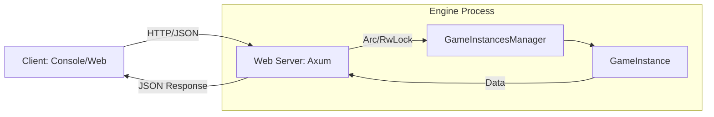

# Decoupling the Game Engine from the Console Client

## Current Architecture
Currently, the `GrandAutoBattler_Console` is a synchronous terminal application that directly calls methods on the `GrandAutoBattler_GameEngine`. 

**Key Coupling Points:**
1. **Direct Function Calls**: The console app calls `GameInstancesManager::new()`, `GetNewGameInstanceId()`, and `GetGameResultByIdAndSelection()` directly.
2. **Shared Memory/Process**: Both the client and engine run in the same process, sharing the same memory space.
3. **Synchronous Execution**: The client waits for the engine to finish calculations (like battle simulation) before it can render the next frame/stage.
4. **Data Ownership**: The `GameState` in the console app and the `GameInstance` in the engine are tightly linked through specific return types.

## Proposed Decoupled Architecture (Web-Server Model)

To support future-proofing (e.g., a web frontend, mobile app, or multiple clients), we will introduce an intermediary **Web Server** layer.

### 1. The Intermediary: Web Server (Axum + Tokio)
Instead of the client calling the engine, the client will send **HTTP Requests** to a standalone Web Server.
* **Protocol**: HTTP (Port 6666).
* **Communication Format**: JSON (via `serde`).
* **Concurrency**: The server will be asynchronous, allowing it to handle multiple client requests without blocking the entire system.

### 2. The Engine as a Service
The `GrandAutoBattler_GameEngine` will be wrapped by the Web Server. The server will hold the `GameInstancesManager` inside an `Arc<RwLock<...>>`.
* **`Arc` (Atomic Reference Counter)**: Allows multiple threads (Axum handlers) to own a reference to the engine.
* **`RwLock` (Read-Write Lock)**: Allows multiple clients to *read* game data (like faction names) simultaneously, but ensures only one client can *write* (like starting a new game) at a time, preventing data races.

### 3. The Client (New Console or Web)
The client becomes "dumb." It no longer knows how to calculate a battle; it only knows how to:
1. Send a `POST /game/new` request.
2. Send a `POST /game/{id}/simulate` request with selected units.
3. Receive a JSON response containing the `GameResult`.

## Transition Plan

### Phase 1: Engine Preparation (Data Serialization)
We must implement `serde::Serialize` and `serde::Deserialize` for all core engine types:
* `Combatant`
* `GameResult`
* `Faction`
* `UnitType`
* `GameResultManager` components

### Phase 2: The API Specification
Define a RESTful contract. 
* **Endpoints**:
    * `POST /game/new` -> returns `game_id`
    * `GET /game/{id}/factions` -> returns list of factions
    * `GET /game/{id}/unit-types` -> returns unit types per faction
    * `POST /game/{id}/simulate` -> takes unit selections, returns `GameResult`

### Phase 3: Implementing the Server
Create a new Rust crate (`Web-Server`) using `Axum`. This crate will:
1. Initialize the Engine.
2. Wrap the Engine in thread-safe primitives (`Arc<RwLock<...>>`).
3. Map HTTP routes to Engine methods.

## Visual Workflow

