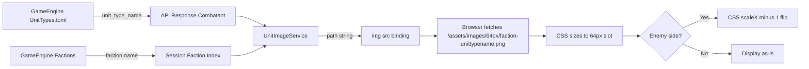

# Image Implementation Guide for GrandAutoBattler Angular UI

## Overview

This guide explains how to implement `` tags in the Angular UI for displaying unit type images, including:
- Image path mapping from game engine TOML files to Angular assets
- Reactive data binding using Angular Signals (`computed`)
- CSS sizing, placeholders, and horizontal flipping
- Browser caching strategies for static assets

---

## 1. Image Asset Structure

Images are stored in the Angular UI under two size directories:

```
src/app/assets/images/
├── 64px/
│   ├── demons-imp.png
│   ├── demons-succubus.png
│   ├── demons-demonologist.png
│   ├── demons-abomination.png
│   ├── humans-knight.png
│   ├── humans-archer.png
│   ├── humans-witch.png
│   └── humans-paladin.png
└── 128px/
    ├── demons-imp.png
    ├── demons-succubus.png
    ├── demons-demonologist.png
    ├── demons-abomination.png
    ├── humans-knight.png
    ├── humans-archer.png
    ├── humans-witch.png
    └── humans-paladin.png
```

### Naming Convention

**Pattern:** `{faction}-{unit_type_name}.png`

| TOML Source | `unit_type_name` | Faction | Image File |
|---|---|---|---|
| `Demons/UnitTypes.toml` | `imp` | `demons` | `demons-imp.png` |
| `Demons/UnitTypes.toml` | `succubus` | `demons` | `demons-succubus.png` |
| `Humans/UnitTypes.toml` | `knight` | `humans` | `humans-knight.png` |
| `Humans/UnitTypes.toml` | `archer` | `humans` | `humans-archer.png` |

The faction key is derived from the directory name under `Factions/` in the game engine assets, lowercased.

---

## 2. How `` Works in Angular

### Basic `` Tag

The HTML `` tag requires:
- **`src`** (mandatory): The URL/path to the image source
- **`alt`** (mandatory for accessibility): Alternative text description

In Angular, we bind the `src` attribute using property binding syntax `[src]`:

```html

```

### Why Property Binding `[src]` and Not `src`?

- **`src="..."`** is a static string known at write time.
- **`[src]="..."`** evaluates the expression at runtime against the component's context, allowing dynamic values from signals or computed properties.

### Minimal Example in Component

```typescript
// In your component .ts
unitImage = computed(() => {
  const unit = this.selectedUnit();
  if (!unit) return '';
  return `/assets/images/64px/demons-${unit.unit_type_name}.png`;
});
```

```html
<!-- In your template .html -->

```

---

## 3. Injectable Image Path Service

Create a service that generates correct image paths based on faction and unit type data. This decouples image logic from components and makes it testable.

### Service Implementation

Create `src/app/core/services/unit-image.service.ts`:

```typescript
import { Injectable, inject, signal, computed } from '@angular/core';
import { GameSessionService } from './game-session.service';

export interface ImageConfig {
  /** Base path for images in the assets folder */
  basePath: string;
  /** Image size variant: '64px' or '128px' */
  size: string;
}

const DEFAULT_CONFIG: ImageConfig = {
  basePath: '/assets/images',
  size: '64px',
};

@Injectable({
  providedIn: 'root',
})
export class UnitImageService {
  private session = inject(GameSessionService);

  // Configuration signal – allows runtime overrides
  private config = signal<ImageConfig>({ ...DEFAULT_CONFIG });

  /** Update configuration (e.g., switch to 128px) */
  updateConfig(partial: Partial<ImageConfig>) {
    this.config.update((current) => ({ ...current, ...partial }));
  }

  /**
   * Generate the image path for a given faction and unit type name.
   * Format: /assets/images/{size}/{faction}-{unit_type_name}.png
   */
  getImagePath(faction: string, unitTypeName: string): string {
    const cfg = this.config();
    return `${cfg.basePath}/${cfg.size}/${faction.toLowerCase()}-${unitTypeName.toLowerCase()}.png`;
  }

  /**
   * Get image path for a combatant on a given side.
   * Side 0 = our side (uses ourFactionIndex)
   * Side 1 = enemy side (uses opponentFactionIndex)
   */
  getCombatantImagePath(combatantUnitTypeName: string, side: 0 | 1): string {
    const factions = this.session.availableFactions();
    const factionIndex = side === 0 ? this.session.ourFactionIndex() : this.session.opponentFactionIndex();
    const faction = factions[factionIndex] ?? 'unknown';
    return this.getImagePath(faction, combatantUnitTypeName);
  }

  /**
   * Check if an image file is expected to exist.
   * Useful for showing fallback placeholders.
   */
  hasImage(faction: string, unitTypeName: string): boolean {
    // For now, assume all combinations exist.
    // In production, you could load a manifest JSON of available images.
    return faction !== 'unknown' && unitTypeName.length > 0;
  }
}
```

### Using the Service in a Component

```typescript
import { Component, inject, computed } from '@angular/core';
import { UnitImageService } from '../../core/services/unit-image.service';
import { GameSessionService } from '../../core/services/game-session.service';
import type { Combatant } from '../../core/models/game.model';

@Component({
  selector: 'app-enemies',
  standalone: true,
  imports: [CommonModule],
  templateUrl: './enemies.html',
  styleUrl: './enemies.scss',
})
export class Enemies {
  session = inject(GameSessionService);
  imageService = inject(UnitImageService);

  ourCombatants = computed(() => {
    const result = this.session.gameResult();
    return result?.generated_combatants?.[0] ?? [];
  });

  enemyCombatants = computed(() => {
    const result = this.session.gameResult();
    return result?.generated_combatants?.[1] ?? [];
  });

  // Computed image path for a combatant
  getCombatantImage = (combatant: Combatant, side: 0 | 1): string => {
    return this.imageService.getCombatantImagePath(combatant.unit_type_name, side);
  };
}
```

```html
<!-- In enemies.html -->
@for (combatant of ourCombatants(); track combatant.id) {
  <div class="combatant-card golden">
    
    <div class="combatant-name">{{ getFullName(combatant) }}</div>
    <!-- ... rest of card ... -->
  </div>
}
```

---

## 4. CSS Sizing and Placeholders

### Fixed-Size Image Slots

Define consistent sizing so the layout does not break when images are missing:

```scss
// In enemies.scss or a shared styles file

// 64px icon variant
.unit-icon {
  width: 64px;
  height: 64px;
  object-fit: contain;      // Scales image to fit without distortion
  background-color: var(--color-placeholder-bg, #ccc); // Placeholder color
  border: 1px solid var(--color-border, #888);
  border-radius: 4px;
  display: block;
  margin: 0 auto;           // Center within card
}

// 128px icon variant (for larger displays)
.unit-icon--large {
  width: 128px;
  height: 128px;
}
```

### Why These CSS Properties Matter

| Property | Purpose |
|---|---|
| `width` / `height` | Reserves a fixed slot so layout is stable even before image loads or if image is missing |
| `object-fit: contain` | Ensures the image scales proportionally to fill the slot without cropping or stretching |
| `background-color` | Acts as a **placeholder** when the image file is missing (browser shows broken image icon over this background) |
| `border` / `border-radius` | Visual framing for the placeholder, making missing images look intentional |

### Placeholder Behavior When Image Is Missing

When the `` points to a non-existent file, the browser:
1. Attempts to load the image (404 error)
2. Displays a broken-image icon
3. The reserved `width`/`height` slot remains intact
4. The `background-color` fills the slot behind the broken icon

To improve this, you can use the `onError` handler to swap to a default placeholder:

```html

```

```typescript
onImageError(event: Event) {
  const img = event.target as HTMLImageElement;
  // Replace with a generic placeholder
  img.src = '/assets/images/64px/unknown-unit.png';
  // Or hide the broken icon and show only background
  img.style.display = 'none';
}
```

---

## 5. Horizontal Image Flipping for Enemy Side

### The Problem

All combatant images face **right** by default. For one side of the battle, this is correct. For the opposing side, images should face **left** to create a natural "facing each other" visual.

### Solution: CSS `transform: scaleX(-1)`

Apply a CSS class that horizontally flips the image:

```scss
// In enemies.scss

.unit-icon--flipped {
  transform: scaleX(-1);
  display: inline-block; // Required for transform to work correctly
}
```

### Applying the Flip in Template

```html
<!-- Our side (side 0) – faces right, no flip -->
@for (combatant of ourCombatants(); track combatant.id) {
  <div class="combatant-card golden">
    
    <!-- ... -->
  </div>
}

<!-- Enemy side (side 1) – faces left, flipped -->
@for (combatant of enemyCombatants(); track combatant.id) {
  <div class="combatant-card magenta">
    
    <!-- ... -->
    </div>
}
```

### Conditional Flip with `[class]` Binding

If you need dynamic control:

```html

```

### How `scaleX(-1)` Works

- `transform: scaleX(-1)` mirrors the element along the Y-axis
- The image pixels are rendered in reverse horizontal order
- The element's layout footprint (width/height in document flow) is **unchanged**
- This is a GPU-accelerated CSS transform – no performance penalty

---

## 6. Browser Caching Strategy for Images

### How Browser Caching Works

When the browser loads an image:
1. It stores the image in the HTTP cache
2. On subsequent visits, it reuses the cached copy
3. Cache behavior is controlled by `Cache-Control` HTTP headers on the server response

### Angular Build and Asset Hashing

**Angular's built-in behavior:**
- JavaScript and CSS files get content hashes in their filenames during production builds (e.g., `main.K4J3H2.js`)
- **Static assets in the `assets` folder are NOT hashed by default** – they are copied as-is

**Implication:** If you update `demons-imp.png` but keep the same filename, users may see the old cached version.

### Solution 1: Server-Side Cache-Control Headers (Recommended)

Configure your web server (e.g., Nginx, Apache) to send proper cache headers:

```nginx
# Nginx example
location /assets/ {
  expires 1y;
  add_header Cache-Control "public, immutable";
}
```

- **`public`**: Any cache (browser, CDN, proxy) may store the response
- **`immutable`**: The browser will not revalidate the resource even with `Cache-Control: no-cache` – it assumes the file never changes while the URL stays the same
- **`expires 1y`**: Sets the max-age to 1 year

**When you add new images or update filenames:** Since the URL changes (new filename), the browser fetches the new file automatically.

### Solution 2: Cache Busting with Content Hash

If you need to update existing image files without changing filenames, use a build-time hash:

1. Install `@sitelintcode/angular-static-assets-hash`
2. Run `npx createAngularStaticHashes` before build
3. This generates `assets.json` with file-to-hash mappings
4. Use the provided `fileHash` pipe in templates:

```html

```

Output: ``

The query parameter `?c=...` forces the browser to treat it as a new resource.

### Solution 3: Service Worker Caching (Advanced)

For Progressive Web App (PWA) scenarios, Angular Service Worker supports cache strategies:

```typescript
// ngsw-config.json
{
  "dataGroups": [
    {
      "name": "images",
      "urls": ["/assets/images/"],
      "cacheConfig": {
        "strategy": "performance",
        "maxSize": 200,
        "maxAge": "365d",
        "timeout": "10s"
      }
    }
  ]
}
```

- **`strategy: "performance"`**: Serve from cache if available, otherwise fetch
- **`maxAge: "365d"`**: Cache entries for 1 year
- **`maxSize: 200`**: Limit cached images to 200 entries

### Recommended Approach for This Project

**Use Solution 1 (Server Headers)** as the primary strategy:
- Images are static game assets that rarely change
- New factions add new filenames, which are automatically fetched
- Simple, reliable, no extra dependencies

---

## 7. Complete Integration Example

### Updated Combatant Model with Faction

The API returns combatants with `unit_type_name`. To map to images, you also need the faction. Extend the model if needed:

```typescript
// In game.model.ts – consider adding faction to Combatant if API supports it
export interface Combatant {
  id: string;
  unit_type_name: string;
  unit_type_pretty_name: string | null;
  faction?: string; // Optional – if API returns it
  // ... rest of fields
}
```

### Final Component Example (Enemies)

```typescript
// enemies.ts
import { Component, inject } from '@angular/core';
import { CommonModule } from '@angular/common';
import { GameSessionService } from '../../core/services/game-session.service';
import { UnitImageService } from '../../core/services/unit-image.service';
import type { Combatant } from '../../core/models/game.model';

@Component({
  selector: 'app-enemies',
  standalone: true,
  imports: [CommonModule],
  templateUrl: './enemies.html',
  styleUrl: './enemies.scss',
})
export class Enemies {
  session = inject(GameSessionService);
  imageService = inject(UnitImageService);

  ourCombatants = () => {
    const result = this.session.gameResult();
    return result?.generated_combatants?.[0] ?? [];
  };

  enemyCombatants = () => {
    const result = this.session.gameResult();
    return result?.generated_combatants?.[1] ?? [];
  };

  getCombatantImage(combatant: Combatant, side: 0 | 1): string {
    return this.imageService.getCombatantImagePath(combatant.unit_type_name, side);
  }

  getFullName(combatant: Combatant): string {
    const first = combatant.first_name ?? '';
    const last = combatant.last_name ?? '';
    return `${first} ${last}`.trim() || 'Unknown';
  }

  getUnitType(combatant: Combatant): string {
    return combatant.unit_type_pretty_name || combatant.unit_type_name;
  }

  onImageError(event: Event) {
    const img = event.target as HTMLImageElement;
    img.style.display = 'none';
  }
}
```

```html
<!-- enemies.html -->
<div class="enemies-container">
  <h2>Battle Forces</h2>

  <div class="combatants-grid">
    <!-- Our side – faces RIGHT -->
    <div class="side our-side">
      <h3 class="side-title golden">Our Forces</h3>
      @for (combatant of ourCombatants(); track combatant.id) {
        <div class="combatant-card golden">
          
          <div class="combatant-name">{{ getFullName(combatant) }}</div>
          <div class="combatant-type">{{ getUnitType(combatant) }}</div>
          <div class="combatant-stats">
            <span>H[{{ combatant.parameters.health }}]</span>
            <span>A[{{ combatant.parameters.attack }}]</span>
            <span>R[{{ combatant.parameters.range }}]</span>
            <span>D[{{ combatant.parameters.defense }}]</span>
          </div>
          <div class="combatant-hp">HP: {{ combatant.health_points }}</div>
        </div>
      }
    </div>

    <!-- Enemy side – faces LEFT (flipped) -->
    <div class="side enemy-side">
      <h3 class="side-title magenta">Enemy Forces</h3>
      @for (combatant of enemyCombatants(); track combatant.id) {
        <div class="combatant-card magenta">
          
          <div class="combatant-name">{{ getFullName(combatant) }}</div>
          <div class="combatant-type">{{ getUnitType(combatant) }}</div>
          <div class="combatant-stats">
            <span>H[{{ combatant.parameters.health }}]</span>
            <span>A[{{ combatant.parameters.attack }}]</span>
            <span>R[{{ combatant.parameters.range }}]</span>
            <span>D[{{ combatant.parameters.defense }}]</span>
          </div>
          <div class="combatant-hp">HP: {{ combatant.health_points }}</div>
        </div>
      }
    </div>
  </div>
</div>
```

```scss
/* enemies.scss */
.combatant-card {
  .unit-icon {
    width: 64px;
    height: 64px;
    object-fit: contain;
    background-color: #a0a0a0;
    border: 1px solid #666;
    border-radius: 4px;
    display: block;
    margin: 0 auto 8px;
  }

  .unit-icon--flipped {
    transform: scaleX(-1);
  }
}
```

---

## 8. Summary Checklist

| Task | Status |
|---|---|
| Create `UnitImageService` with `getImagePath()` and `getCombatantImagePath()` | Pending |
| Add `` tags with `[src]` binding to computed image paths | Pending |
| Apply CSS `.unit-icon` with fixed `64px` size and placeholder background | Pending |
| Apply CSS `.unit-icon--flipped` with `transform: scaleX(-1)` for enemy side | Pending |
| Add `(error)` handler for missing images | Pending |
| Configure server `Cache-Control: public, immutable` for `/assets/images/` | Pending |
| Add `loading="lazy"` for deferred image loading | Pending |
| Test with new faction images not yet present to verify placeholder behavior | Pending |

---

## 9. Mermaid Diagram – Data Flow



---

## 10. Future Considerations

1. **Image Manifest:** Generate a JSON file during build listing all available images. The `UnitImageService.hasImage()` can then check against this manifest instead of assuming all combinations exist.

2. **Skeleton Loading:** Replace the gray placeholder with animated skeleton loaders for a smoother user experience while images load.

3. **Responsive Images:** Use `<picture>` element with `srcset` to serve different image sizes based on screen resolution.

4. **WebP Conversion:** Convert PNG images to WebP format for smaller file sizes, with PNG fallback via `<picture>` element.

5. **Sprite Sheet:** For many small unit icons, consider combining all images into a single sprite sheet and using `background-position` CSS to display individual icons – reducing HTTP requests.
