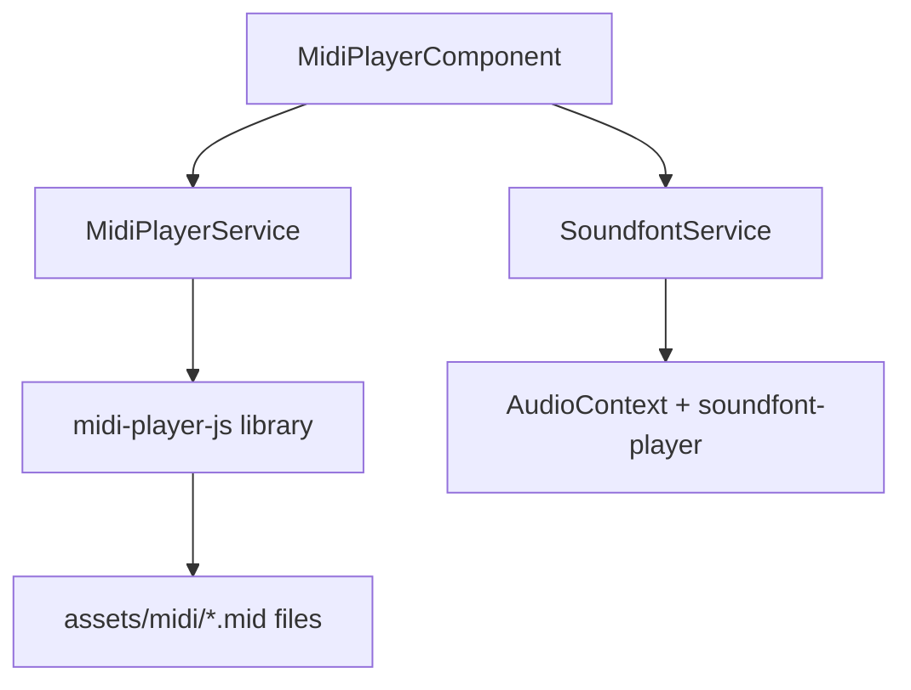

# Complete Guide: MIDI Player in Angular with Injectable Services

## Architecture Overview

This guide provides **ready-to-copy files** for a MIDI player that automatically plays songs and allows the user to skip to the next track and adjust volume. Play/pause is intentionally omitted for simplicity.



---

## Prerequisites

### Asset Configuration

Your `angular.json` must serve the MIDI files. If `src/app/assets` is not already in the `assets` array, add it:

```json
"assets": [
  {
    "glob": "**/*",
    "input": "public"
  },
  {
    "glob": "**/*",
    "input": "src/app/assets"
  }
],
```

### Install Dependencies

```bash
npm install midi-player-js soundfont-player @types/midi-player-js
```

**Note:** `midi-player-js` does **not** produce audio. It parses MIDI files and emits note events. `soundfont-player` handles actual sound synthesis via Web Audio API.

---

## Valid midi-player-js Events

The library (`midi-player-js`) supports exactly these player events, as defined in its type definitions:

| Event | Trigger |
|-------|---------|
| `"midiEvent"` | Fired for every MIDI event (note on, note off, tempo change, etc.) |
| `"endOfFile"` | Playback reaches the end of the MIDI file |
| `"playing"` | Playback starts |
| `"fileLoaded"` | File finishes parsing/loading |

**There is NO `"paused"` event.** The player has a `pause()` method and `isPlaying()` check, but it does not emit a pause event.

---

## Step 1: MidiPlayerService

**File:** `src/app/core/services/midi-player.service.ts`

This service wraps `midi-player-js`. It loads MIDI files via `fetch()` + `loadArrayBuffer()`, emits note events for the soundfont service, and tracks basic playback state.

```typescript
import { Injectable, signal, inject, DestroyRef } from '@angular/core';
import { Subject, Observable } from 'rxjs';
import * as MidiPlayer from 'midi-player-js';

export interface MidiNoteEvent {
  note: number;       // MIDI note number (0-127)
  velocity: number;   // 0-127
  noteName: string;   // e.g., "C4", "D#5"
  isNoteOn: boolean;  // true = Note on, false = Note off
}

@Injectable({
  providedIn: 'root'
})
export class MidiPlayerService {
  private destroyRef = inject(DestroyRef);

  // Reactive state
  private _isPlaying = signal<boolean>(false);
  isPlaying = this._isPlaying.asReadonly();

  // Event stream for note-on / note-off
  private noteSubject = new Subject<MidiNoteEvent>();
  noteEvents$: Observable<MidiNoteEvent> = this.noteSubject.asObservable();

  // Internal player instance
  private player: MidiPlayer.Player | null = null;

  constructor() {
    this.initPlayer();
  }

  private initPlayer(): void {
    this.player = new MidiPlayer.Player((event: MidiPlayer.Event) => {
      if (event.name === 'Note on' || event.name === 'Note off') {
        this.noteSubject.next({
          note: event.noteNumber ?? 0,
          velocity: event.velocity ?? 0,
          noteName: event.noteName ?? event.note ?? 'C4',
          isNoteOn: event.name === 'Note on' && (event.velocity ?? 0) > 0
        });
      }
    });

    // Only use valid events from PlayerEventType
    this.player.on('playing', () => {
      this._isPlaying.set(true);
    });

    this.player.on('endOfFile', () => {
      this._isPlaying.set(false);
    });
  }

  /**
   * Load a MIDI file from an asset path.
   * loadArrayBuffer() is synchronous and returns `this`, not a Promise.
   */
  loadMidi(assetPath: string): Promise<void> {
    return fetch(assetPath)
      .then(response => {
        if (!response.ok) throw new Error(`Failed to load MIDI: ${assetPath}`);
        return response.arrayBuffer();
      })
      .then(buffer => {
        // loadArrayBuffer is synchronous - does NOT return a Promise
        this.player?.loadArrayBuffer(buffer);
      });
  }

  play(): void {
    this.player?.play();
  }

  stop(): void {
    this.player?.stop();
    this._isPlaying.set(false);
  }

  destroy(): void {
    this.stop();
    this.noteSubject.complete();
  }
}
```

### Key Points

- **`loadArrayBuffer()` is synchronous.** The method returns `this` (the player instance), not a Promise. The `fetch()` Promise handles async loading of the file; once the buffer is ready, pass it to `loadArrayBuffer()`.
- **No `'paused'` listener.** The library does not emit a `'paused'` event. Since we removed play/pause, this is irrelevant.
- **`noteEvents$`** is consumed by `SoundfontService` to trigger actual sound.

---

## Step 2: SoundfontService

**File:** `src/app/core/services/soundfont.service.ts`

This service manages the Web Audio API context and soundfont instruments. It subscribes to MIDI note events and plays corresponding notes.

```typescript
import { Injectable, inject, signal, DestroyRef } from '@angular/core';
import { MidiPlayerService } from './midi-player.service';
import * as Soundfont from 'soundfont-player';

@Injectable({
  providedIn: 'root'
})
export class SoundfontService {
  private midiPlayer = inject(MidiPlayerService);
  private destroyRef = inject(DestroyRef);

  private audioContext: AudioContext | null = null;
  private piano: Soundfont.Instrument | null = null;

  // Volume control (0.0 to 1.0)
  private _volume = signal<number>(0.5);
  volume = this._volume.asReadonly();

  constructor() {
    this.subscribeToMidiEvents();
  }

  /**
   * Initialize AudioContext lazily on first user gesture.
   * Browsers require user interaction before creating/resuming AudioContext.
   */
  private ensureAudioContext(): void {
    if (!this.audioContext) {
      this.audioContext = new (window.AudioContext || (window as any).webkitAudioContext)();
    }
    if (this.audioContext.state === 'suspended') {
      this.audioContext.resume();
    }
  }

  /**
   * Load the soundfont instrument.
   * Call this on first user interaction to satisfy browser audio policy.
   */
  async loadInstrument(): Promise<void> {
    this.ensureAudioContext();
    if (!this.audioContext || this.piano) return;

    this.piano = await Soundfont.instrument(
      this.audioContext,
      'acoustic_grand_piano',
      {
        gain: this._volume()
      }
    );
  }

  private subscribeToMidiEvents(): void {
    this.midiPlayer.noteEvents$.subscribe((event) => {
      if (!this.piano || !this.audioContext) return;

      if (event.isNoteOn) {
        // Combine slider volume with MIDI velocity for expressive playback
        const gain = this._volume() * (event.velocity / 127);
        this.piano.play(event.noteName, this.audioContext.currentTime, {
          gain: gain
        });
      }
      // Note off: soundfont-player notes decay naturally via ADSR envelope
    });

    // Cleanup on destroy
    this.destroyRef.onDestroy(() => {
      this.audioContext?.close();
    });
  }

  setVolume(value: number): void {
    this._volume.set(Math.max(0, Math.min(1, value)));
  }
}
```

### Key Points

- **`AudioContext` is created lazily** on first user gesture (browser policy).
- **`soundfont-player` loads from a CDN** (`gleitz.github.io`). First load downloads ~2-5 MB.
- **Gain is per-note**, combining the volume slider with MIDI velocity for dynamics.
- **Notes decay naturally** via the ADSR envelope; explicit note-off is not needed.

---

## Step 3: MidiPlayerComponent

**File:** `src/app/components/midi-player/midi-player.component.ts`

This component ties the two services together. It features auto-play on load, a "Next" button for random track selection, and a volume slider. No play/pause.

```typescript
import {
  Component,
  OnInit,
  inject,
  signal
} from '@angular/core';
import { CommonModule } from '@angular/common';
import { MidiPlayerService } from '../../core/services/midi-player.service';
import { SoundfontService } from '../../core/services/soundfont.service';

const MIDI_FILES = [
  'all_as_one.mid',
  'away.mid',
  'despair.mid',
  'grand.mid',
  'jakusha.mid',
  'kaijuu.mid',
  'sensou_to_sensou.mid'
];

@Component({
  selector: 'app-midi-player',
  standalone: true,
  imports: [CommonModule],
  templateUrl: './midi-player.component.html',
  styleUrl: './midi-player.component.scss'
})
export class MidiPlayerComponent implements OnInit {
  midiPlayer = inject(MidiPlayerService);
  soundfontService = inject(SoundfontService);

  isPlaying = this.midiPlayer.isPlaying;
  isLoading = signal(false);
  currentSongName = '';
  private playedIndices = new Set<number>();

  ngOnInit(): void {
    this.playRandomSong();
  }

  async playRandomSong(): Promise<void> {
    this.isLoading.set(true);

    // Reset if all songs have played
    if (this.playedIndices.size >= MIDI_FILES.length) {
      this.playedIndices.clear();
    }

    let index: number;
    do {
      index = Math.floor(Math.random() * MIDI_FILES.length);
    } while (this.playedIndices.has(index));

    this.playedIndices.add(index);
    const fileName = MIDI_FILES[index];
    this.currentSongName = fileName.replace('.mid', '').replace(/_/g, ' ');

    await this.midiPlayer.loadMidi(`/assets/midi/${fileName}`);
    this.isLoading.set(false);

    // Auto-play after loading
    this.midiPlayer.play();
  }

  async playNextRandom(): Promise<void> {
    this.midiPlayer.stop();
    await this.playRandomSong();
  }

  onVolumeChange(event: Event): void {
    const target = event.target as HTMLInputElement;
    this.soundfontService.setVolume(parseFloat(target.value));
  }
}
```

### Template

**File:** `src/app/components/midi-player/midi-player.component.html`

```html
<div class="midi-player">
  <button
    class="next-btn"
    (click)="playNextRandom()"
    [disabled]="isLoading()"
  >
    Next Track
  </button>

  <div class="volume-control">
    <span>Volume</span>
    <input
      type="range"
      min="0"
      max="1"
      step="0.01"
      [value]="soundfontService.volume()"
      (input)="onVolumeChange($event)"
    />
    <span>{{ (soundfontService.volume() * 100) | number:'1.0-0' }}%</span>
  </div>

  <p class="current-song">{{ currentSongName }}</p>
</div>
```

### Styles

**File:** `src/app/components/midi-player/midi-player.component.scss`

```scss
.midi-player {
  display: flex;
  align-items: center;
  gap: 12px;
  padding: 12px 16px;
  background: var(--surface-color, #1e1e2e);
  border-radius: 8px;

  .next-btn {
    border: none;
    background: var(--primary-color, #4a90d9);
    color: white;
    padding: 8px 16px;
    border-radius: 4px;
    cursor: pointer;
    font-size: 14px;

    &:disabled {
      opacity: 0.5;
      cursor: not-allowed;
    }

    &:hover:not(:disabled) {
      background: var(--primary-hover, #357abd);
    }
  }

  .volume-control {
    display: flex;
    align-items: center;
    gap: 8px;
    margin-left: auto;

    input[type="range"] {
      width: 100px;
    }
  }

  .current-song {
    margin: 0;
    font-size: 12px;
    color: var(--text-muted, #888);
    min-width: 120px;
  }
}
```

---

## Step 4: Activate on First User Interaction

Browsers block `AudioContext` until the user interacts with the page. Hook into any existing click (e.g., navigation bar, a "start" button) to trigger instrument loading:

**In your app root component or navigation component:**

```typescript
import { Component } from '@angular/core';
import { SoundfontService } from './core/services/soundfont.service';

@Component({
  // ... your component config
})
export class YourComponent {
  private soundfont = inject(SoundfontService);

  // Call this from any button click handler
  async onUserInteraction(): Promise<void> {
    await this.soundfont.loadInstrument();
  }
}
```

**Alternatively**, if you want the first click on the "Next Track" button to trigger it, modify `playNextRandom()`:

```typescript
async playNextRandom(): Promise<void> {
  await this.soundfontService.loadInstrument();
  this.midiPlayer.stop();
  await this.playRandomSong();
}
```

---

## Step 5: Embed the Component

Import `MidiPlayerComponent` in whichever component should display it:

```typescript
@Component({
  selector: 'app-navigation',
  standalone: true,
  imports: [RouterLink, RouterLinkActive, MidiPlayerComponent],
  // ...
})
```

Then place `<app-midi-player />` in the template.

---

## MIDI File Caching Strategy

MIDI files are small static assets (typically 5-50 KB). Cache them to reduce load time.

### Option 1: Browser HTTP Caching (Simplest)

Configure your production server to send long cache headers for `.mid` files:

```
Cache-Control: public, max-age=31536000, immutable
```

### Option 2: Angular Service Worker (Recommended)

```bash
ng add @angular/service-worker
```

In `ngsw-config.json`, add MIDI files to asset groups:

```json
{
  "index": "/index.html",
  "assetGroups": [
    {
      "name": "midi-assets",
      "installMode": "prefetch",
      "resources": {
        "urls": ["/assets/midi/**/*.mid"]
      }
    }
  ]
}
```

---

## Summary Checklist

| Step | Action |
|------|--------|
| 1 | Ensure `src/app/assets` is in `angular.json` assets |
| 2 | `npm install midi-player-js soundfont-player` |
| 3 | Create `MidiPlayerService` with correct `loadArrayBuffer()` usage |
| 4 | Create `SoundfontService` with lazy `AudioContext` init |
| 5 | Create `MidiPlayerComponent` with next-track and volume UI |
| 6 | Trigger `loadInstrument()` on first user gesture |
| 7 | Embed component where needed |

---

## Troubleshooting

| Problem | Solution |
|---------|----------|
| No sound on first play | Call `soundfontService.loadInstrument()` from a user click handler. Browsers block AudioContext until interaction. |
| `fetch()` fails with 404 | Verify `angular.json` asset config. Test by navigating to `http://localhost:4200/assets/midi/all_as_one.mid`. |
| Sound loads slowly | The first `loadInstrument()` call downloads ~2-5 MB from the soundfont CDN. Consider preloading at app bootstrap. |
| Memory leaks on route change | Call `midiPlayer.stop()` and `noteSubject.complete()` on destroy. |
| Notes sound out of tune | `midi-player-js` emits `noteName` like `"C4"`. `soundfont-player` expects the same format. Log `event.noteName` to verify. |
