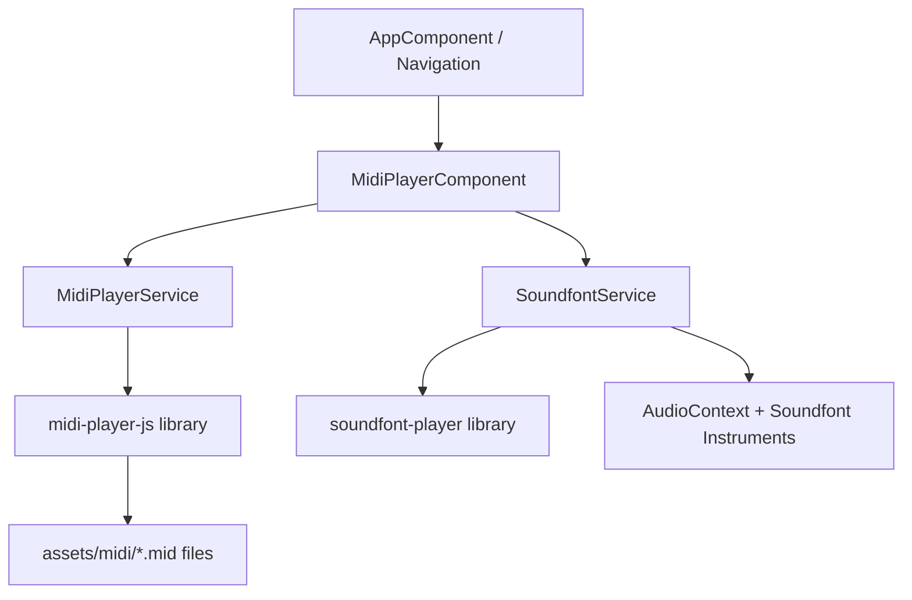

# Complete Guide: MIDI Player in Angular with Injectable Services

## Architecture Overview

This guide covers how to implement a fully functional MIDI player in your Angular project using **two separate injectable services** and a **component** that ties them together.



---

## Prerequisites: Asset Configuration

**CRITICAL:** Your current [`angular.json`](GrandAutoBattler_Angular_UI/angular.json:27) only maps the `public` folder as an asset. Your MIDI files live in `src/app/assets/midi/`, which is **not** served by Angular's dev server.

**Fix:** Add the `src/app/assets` folder to the assets array in [`angular.json`](GrandAutoBattler_Angular_UI/angular.json:27):

```json
"assets": [
  {
    "glob": "**/*",
    "input": "public"
  },
  {
    "glob": "**/*",
    "input": "src/app/assets"
  }
],
```

This ensures files like `/assets/midi/all_as_one.mid` are accessible via HTTP at runtime.

---

## Step 1: Install Dependencies

```bash
npm install midi-player-js soundfont-player
```

**Note on `soundfont-player`:** The original `soundfont-player` library by `danigb` is **archived** (read-only since May 2023). The author recommends [`smplr`](https://github.com/danigb/smplr) as a modern alternative. However, `soundfont-player` still works and is simpler for MIDI use cases. If you encounter issues, consider `smplr`.

---

## Step 2: Create the MidiPlayerService

**Location:** `src/app/core/services/midi-player.service.ts`

This service wraps `midi-player-js` and handles MIDI file parsing, playback control, and emitting events. It does **NOT** produce sound — that is the job of `SoundfontService`.

### Key Responsibilities:
- Initialize `MidiPlayer.Player` instance
- Load MIDI files from assets via `fetch()` + `loadArrayBuffer()`
- Emit `Subject`s for note events, playback state changes
- Expose `play()`, `pause()`, `stop()` methods

### Implementation Guide:

```typescript
import { Injectable, signal, DestroyRef, inject } from '@angular/core';
import { Subject, Observable } from 'rxjs';
import * as MidiPlayer from 'midi-player-js';

export interface MidiNoteEvent {
  note: number;       // MIDI note number (0-127)
  velocity: number;   // 0-127
  noteName: string;   // e.g., "C4", "D#5"
  isNoteOn: boolean;  // true = Note on, false = Note off
}

@Injectable({
  providedIn: 'root'
})
export class MidiPlayerService {
  private destroyRef = inject(DestroyRef);

  // Reactive state using signals (Angular v16+)
  private _isPlaying = signal<boolean>(false);
  private _isPaused = signal<boolean>(false);
  isPlaying = this._isPlaying.asReadonly();
  isPaused = this._isPaused.asReadonly();

  // Event stream for note-on / note-off
  private noteSubject = new Subject<MidiNoteEvent>();
  noteEvents$: Observable<MidiNoteEvent> = this.noteSubject.asObservable();

  // Internal player instance
  private player: MidiPlayer.Player | null = null;

  constructor() {
    this.initPlayer();
  }

  private initPlayer(): void {
    this.player = new MidiPlayer.Player((event: any) => {
      if (event.name === 'Note on' || event.name === 'Note off') {
        this.noteSubject.next({
          note: event.note.number,
          velocity: event.velocity,
          noteName: event.note.name,
          isNoteOn: event.name === 'Note on' && event.velocity > 0
        });
      }
    });

    this.player.on('playing', () => {
      this._isPlaying.set(true);
      this._isPaused.set(false);
    });

    this.player.on('endOfFile', () => {
      this._isPlaying.set(false);
      this._isPaused.set(false);
    });

    this.player.on('paused', () => {
      this._isPaused.set(true);
    });
  }

  /**
   * Load a MIDI file from an asset path.
   * Uses fetch() + ArrayBuffer, which is the most reliable method in browsers.
   */
  loadMidi(assetPath: string): Promise<void> {
    return fetch(assetPath)
      .then(response => {
        if (!response.ok) throw new Error(`Failed to load MIDI: ${assetPath}`);
        return response.arrayBuffer();
      })
      .then(buffer => {
        this.player?.loadArrayBuffer(buffer);
      });
  }

  play(): void {
    this.player?.play();
  }

  pause(): void {
    this.player?.pause();
  }

  stop(): void {
    this.player?.stop();
    this._isPlaying.set(false);
    this._isPaused.set(false);
  }

  // Cleanup on component destruction
  destroy(): void {
    this.stop();
    this.noteSubject.complete();
  }
}
```

### Important Notes:
- Use `inject(DestroyRef)` instead of implementing `OnDestroy` — this is modern Angular (v16+).
- `signal()` is used for reactive state (Angular v16+). You can use `BehaviorSubject` if you prefer RxJS-only.
- The `noteEvents$` Observable is what the `SoundfontService` will subscribe to.

---

## Step 3: Create the SoundfontService

**Location:** `src/app/core/services/soundfont.service.ts`

This service manages Web Audio API context and soundfont instruments. It subscribes to the MIDI note events and triggers actual audio synthesis.

### Key Responsibilities:
- Create and manage `AudioContext`
- Load soundfont instruments (piano, strings, drums, etc.) via `soundfont-player`
- Subscribe to `MidiPlayerService.noteEvents$` and play corresponding notes
- Handle volume control via gain

### Implementation Guide:

```typescript
import { Injectable, inject, signal } from '@angular/core';
import { MidiPlayerService, MidiNoteEvent } from './midi-player.service';
import * as Soundfont from 'soundfont-player';

@Injectable({
  providedIn: 'root'
})
export class SoundfontService {
  private midiPlayer = inject(MidiPlayerService);
  private audioContext: AudioContext | null = null;
  private piano: any = null;

  // Volume control (0.0 to 1.0), defaults to 50%
  private _volume = signal<number>(0.5);
  volume = this._volume.asReadonly();

  constructor() {
    this.initAudioContext();
    this.subscribeToMidiEvents();
  }

  private initAudioContext(): void {
    // AudioContext must be created after user gesture in some browsers
    this.audioContext = new (window.AudioContext || (window as any).webkitAudioContext)();
  }

  /**
   * Load the soundfont instrument.
   * Call this once at app bootstrap or on first user interaction.
   */
  async loadInstrument(): Promise<void> {
    if (!this.audioContext || this.piano) return;

    // Load acoustic_grand_piano from Benjamin Gleitzman's soundfont
    this.piano = await Soundfont.instrument(this.audioContext, 'acoustic_grand_piano', {
      gain: this._volume()
    });
  }

  private subscribeToMidiEvents(): void {
    this.midiPlayer.noteEvents$.subscribe((event: MidiNoteEvent) => {
      if (!this.piano) return;

      if (event.isNoteOn) {
        // Calculate gain: combine slider volume with MIDI velocity
        const gain = this._volume() * (event.velocity / 127);
        this.piano.play(event.noteName, this.audioContext?.currentTime, {
          gain: gain
        });
      }
      // Note off - soundfont-player notes decay naturally via ADSR envelope
    });
  }

  setVolume(value: number): void {
    this._volume.set(Math.max(0, Math.min(1, value)));
  }

  /**
   * Resume audio context if suspended (required by browsers on first user gesture).
   * Call this from your component's play button click handler.
   */
  async resumeContext(): Promise<void> {
    if (this.audioContext?.state === 'suspended') {
      await this.audioContext.resume();
    }
  }

  destroy(): void {
    this.piano?.stop();
    this.audioContext?.close();
  }
}
```

### Important Notes:
- `AudioContext` is **suspended** by default in modern browsers until a user gesture (click/tap). You must call `resumeContext()` from your play button handler.
- `soundfont-player` loads instruments from a remote CDN (`gleitz.github.io`). The first load may take time — consider **preloading** on app bootstrap or showing a loading indicator.
- The `gain` option controls per-note volume. Combine it with the slider volume and MIDI velocity for expressive playback.
- `soundfont-player` does not have fine-grained per-note stop. Notes decay naturally via the ADSR envelope.

---

## Step 4: Register Services in App Config

**Location:** [`app.config.ts`](GrandAutoBattler_Angular_UI/src/app/app.config.ts:1)

Since both services use `providedIn: 'root'`, they are **automatically available** as singletons. No extra registration needed.

However, preload the soundfont instrument at app startup to avoid delays on first play.

In your [`app.ts`](GrandAutoBattler_Angular_UI/src/app/app.ts:1) or a dedicated app initializer, inject and call:

```typescript
import { SoundfontService } from './core/services/soundfont.service';

// Somewhere early in app lifecycle (e.g., in AppComponent.ngOnInit):
this.soundfontService.loadInstrument();
```

---

## Step 5: Create the MidiPlayerComponent

**Location:** `src/app/components/midi-player/midi-player.component.ts`

This component orchestrates the two services and provides UI controls.

### Template (`midi-player.component.html`):

```html
<div class="midi-player">
  <button class="play-btn" (click)="togglePlayPause()" [disabled]="isLoading">
    {{ isPlaying() && !isPaused() ? 'Pause' : 'Play' }}
  </button>

  <button class="next-btn" (click)="playNextRandom()">
    Next >>
  </button>

  <div class="volume-control">
    <span>Volume</span>
    <input
      type="range"
      min="0"
      max="1"
      step="0.01"
      [value]="soundfontService.volume()"
      (input)="onVolumeChange($event)"
    />
    <span>{{ (soundfontService.volume() * 100) | number:'1.0' }}%</span>
  </div>

  <p class="current-song">{{ currentSongName }}</p>
</div>
```

### Styles (`midi-player.component.scss`):

```scss
.midi-player {
  display: flex;
  align-items: center;
  gap: 12px;
  padding: 12px 16px;
  background: var(--surface-color, #1e1e2e);
  border-radius: 8px;

  .play-btn, .next-btn {
    border: none;
    background: var(--primary-color, #4a90d9);
    color: white;
    padding: 8px 16px;
    border-radius: 4px;
    cursor: pointer;
    font-size: 14px;

    &:disabled {
      opacity: 0.5;
      cursor: not-allowed;
    }

    &:hover:not(:disabled) {
      background: var(--primary-hover, #357abd);
    }
  }

  .volume-control {
    display: flex;
    align-items: center;
    gap: 8px;
    margin-left: auto;

    input[type="range"] {
      width: 100px;
    }
  }

  .current-song {
    margin: 0;
    font-size: 12px;
    color: var(--text-muted, #888);
  }
}
```

### Component Class:

```typescript
import {
  Component,
  OnInit,
  OnDestroy,
  inject,
  signal
} from '@angular/core';
import { CommonModule } from '@angular/common';
import { Subject } from 'rxjs';

import { MidiPlayerService } from '../../core/services/midi-player.service';
import { SoundfontService } from '../../core/services/soundfont.service';

// List of available MIDI files in assets/midi/
const MIDI_FILES = [
  'all_as_one.mid',
  'away.mid',
  'despair.mid',
  'grand.mid',
  'jakusha.mid',
  'kaijuu.mid',
  'sensou_to_sensou.mid'
];

@Component({
  selector: 'app-midi-player',
  standalone: true,
  imports: [CommonModule],
  templateUrl: './midi-player.component.html',
  styleUrl: './midi-player.component.scss'
})
export class MidiPlayerComponent implements OnInit, OnDestroy {
  midiPlayer = inject(MidiPlayerService);
  soundfontService = inject(SoundfontService);

  // Reactive signals from services
  isPlaying = this.midiPlayer.isPlaying;
  isPaused = this.midiPlayer.isPaused;

  // Local state
  isLoading = signal(false);
  currentSongName = '';
  private playedIndices = new Set<number>();

  private destroy$ = new Subject<void>();

  ngOnInit(): void {
    // Pick initial random song
    this.playRandomSong();
  }

  /**
   * Pick a random MIDI file and load it.
   */
  async playRandomSong(): Promise<void> {
    this.isLoading.set(true);

    // Pick random index not yet played, or reset if all played
    if (this.playedIndices.size >= MIDI_FILES.length) {
      this.playedIndices.clear();
    }

    let index: number;
    do {
      index = Math.floor(Math.random() * MIDI_FILES.length);
    } while (this.playedIndices.has(index));

    this.playedIndices.add(index);
    const fileName = MIDI_FILES[index];
    this.currentSongName = fileName.replace('.mid', '').replace(/_/g, ' ');

    await this.midiPlayer.loadMidi(`/assets/midi/${fileName}`);
    this.isLoading.set(false);
  }

  /**
   * Play next random song (triggered by "next" button).
   */
  async playNextRandom(): Promise<void> {
    this.midiPlayer.stop();
    await this.playRandomSong();
    this.togglePlayPause();
  }

  /**
   * Toggle between play and pause.
   * IMPORTANT: Resume AudioContext on first play (browser requirement).
   */
  async togglePlayPause(): Promise<void> {
    if (this.isPlaying() && !this.isPaused()) {
      this.midiPlayer.pause();
    } else {
      // Resume AudioContext from suspended state (browser policy)
      await this.soundfontService.resumeContext();
      this.midiPlayer.play();
    }
  }

  onVolumeChange(event: Event): void {
    const target = event.target as HTMLInputElement;
    const value = parseFloat(target.value);
    this.soundfontService.setVolume(value);
  }

  ngOnDestroy(): void {
    this.destroy$.next();
    this.destroy$.complete();
    this.midiPlayer.stop();
  }
}
```

### Key Design Decisions:
1. **Random selection without immediate repeats:** Uses a `Set` to track played indices. Resets after all songs have played once.
2. **`playNextRandom()` stops current song before loading next.** Prevents audio overlap.
3. **`resumeContext()` on play:** Browsers suspend `AudioContext` until user gesture. The play button click satisfies this requirement.
4. **Volume defaults to 50%:** The signal is initialized to `0.5` in `SoundfontService`.

---

## Step 6: Embed in Navigation or Main Page

The component is **standalone** (not in an NgModule), so import it wherever you need:

**Option A: Inside the Navigation component**

In [`navigation.ts`](GrandAutoBattler_Angular_UI/src/app/components/navigation/navigation.ts:8), add `MidiPlayerComponent` to the `imports` array:

```typescript
@Component({
  selector: 'app-navigation',
  standalone: true,
  imports: [RouterLink, RouterLinkActive, MidiPlayerComponent],
  // ...
})
```

Then in `navigation.html`, place `<app-midi-player />` where you want it.

**Option B: In the main app shell**

In [`app.html`](GrandAutoBattler_Angular_UI/src/app/app.html:1), add `<app-midi-player />` directly if it should be visible on all pages.

---

## MIDI File Caching Strategy

MIDI files are static binary assets that do not change frequently. Caching them reduces load time and bandwidth on subsequent visits. Unlike images, MIDI files are smaller (typically 5-50 KB) but still benefit from caching, especially on slow connections.

### Option 1: Browser HTTP Caching (Simplest)

Configure your production web server to send long cache headers for `.mid` files:

```
Cache-Control: public, max-age=31536000, immutable
```

- `max-age=31536000` = 1 year
- `immutable` = browser will not send revalidation requests

This works automatically with `fetch()` — the browser will serve from cache if the URL has not changed.

### Option 2: Service Worker with Angular PWA (Recommended)

Use Angular's built-in service worker for robust caching:

1. Install:
   ```bash
   ng add @angular/service-worker
   ```

2. In the generated `ngsw-config.json`, add MIDI files to the **asset groups**:
   ```json
   {
     "index": "/index.html",
     "assetGroups": [
       {
         "name": "midi-assets",
         "installMode": "prefetch",
         "resources": {
           "urls": ["/assets/midi/**/*.mid"]
         }
       }
     ]
   }
   ```

This **prefetches** all MIDI files at install time and serves them from cache on subsequent loads. The `prefetch` mode ensures all songs are available offline after first visit.

### Option 3: Manual Cache API in Custom Service Worker

If you want fine-grained control, register a custom service worker that intercepts `/assets/midi/` requests and uses the Cache API directly. This gives you stale-while-revalidate behavior but requires more boilerplate.

### Recommendation

For your project: **Use Angular's built-in service worker** (Option 2). It integrates seamlessly, requires minimal configuration, and handles cache versioning automatically. MIDI files are ideal for prefetch because they are small, static, and known upfront.

---

## Summary Checklist

| Step | Action |
|------|--------|
| 1 | Add `src/app/assets` to `angular.json` assets |
| 2 | `npm install midi-player-js soundfont-player` |
| 3 | Create `MidiPlayerService` with `fetch()` + `loadArrayBuffer()` |
| 4 | Create `SoundfontService` with `AudioContext` + instrument loading |
| 5 | Create `MidiPlayerComponent` with random song selection |
| 6 | Wire play/pause, next song, volume slider UI |
| 7 | Embed component in navigation or main page |
| 8 | Configure Service Worker for MIDI caching |

---

## Troubleshooting

| Problem | Solution |
|---------|----------|
| No sound on first play | Call `soundfontService.resumeContext()` inside the play button handler. Browsers suspend AudioContext until user gesture. |
| `fetch()` fails with 404 | Verify `angular.json` asset configuration. Test by navigating to `http://localhost:4200/assets/midi/all_as_one.mid` — it should download. |
| Notes sound out of tune | `midi-player-js` emits note names like `C4`. `soundfont-player` expects the same format. If notes sound wrong, log `event.note.name` to verify. |
| Soundfont loads slowly | Preload `loadInstrument()` at app bootstrap. First instrument load downloads ~2-5 MB from CDN. |
| Memory leaks on route change | Call `midiPlayer.stop()` in `ngOnDestroy`. |
