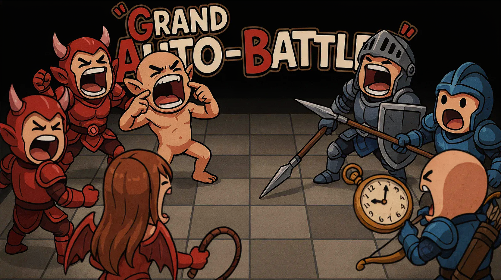
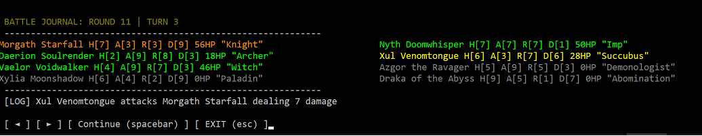
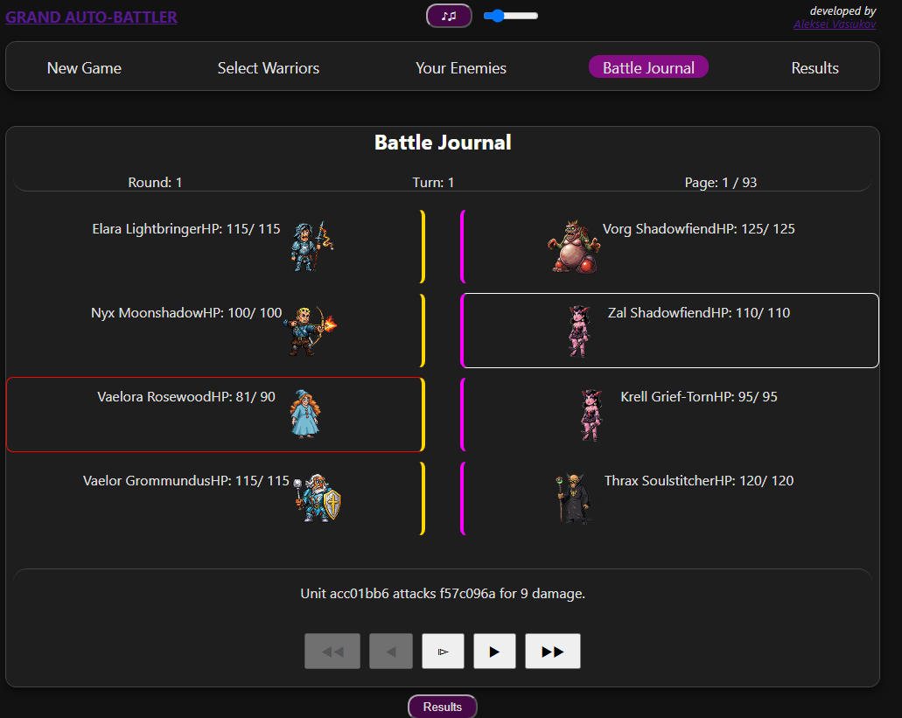
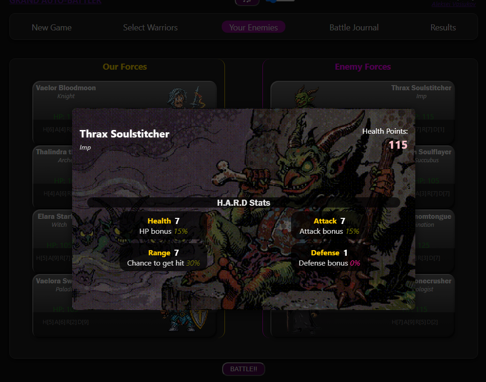

# **RUST project** by Aleksei Vasiukov (2026)

## Computer game "Grand Auto-Battler".

[https:://GrandAutoBattler.com](GrandAutoBattler.com)



This is the game of the **two parties fighting each other**.
Left party (ours) consist of selectable characters (4 maximum). The opposite party (enemy, on the right) is generated with equal warriors number. Every warrior has distributed his 20 skill points (out of 40) respectively to their unit type. Health, Attack, Range and Defense (so called **H.A.R.D system**) are distinguish close-quarters swordsman from long-ranged archer.

The design-document can be found in:
[Docs/FinalProject_Rust_Vasiukov.pptx](/Docs/FinalProject_Rust_Vasiukov.pptx)

The calculations of units types parameters proportions can be found in:
[Docs/UnitsParametersCalculations.xlsx](Docs/UnitsParametersCalculations.xlsx)

The schema of server-client integration is in: [Docs/WebUi-BackEnd-GameEngine.png](Docs/WebUi-BackEnd-GameEngine.png)

## **CONTENTS**:

```
                                                         GrandAutoBattler_Console_Runner
                                                        / (prepare assets, run build.rs, run console,)
                               GrandAutoBattler_Console
                             / (console app logic, raw mode)
GrandAutoBattler_GameEngine-
(main logic, calculations)   \
                               GrandAutoBattler_API_Runner
                               (WEbApi, assets, build.rs, openApi)
                             /
                           /
GrandAutoBattler_Angular_UI
(AngularJS webUi consuming webAPI)

```

### RUST-based projects

<details>

<summary>- <b>GrandAutoBattler_GameEngine:</b>:</summary>

Functional game engine, client-agnostic and result-patterned with the following features:

- Parsing configuration and game entities from TOML files.
- In-memory storage of the game instances
- Generation of different gameplay characters with the characteristics specific to their type.
- Calculation of the whole battle outcome: chances to be hit, attack and defence level and current HP.
- Having a WiP tests to cover functionality.
- Methods are client-agnostic (used by Console and WebApi applications).

<p>How-to-use:</p>

Install `rustup` on your computer
NAVIGATE YOURSELF TO [GrandAutoBattler/GrandAutoBattler_GameEngine/](GrandAutoBattler/GrandAutoBattler_GameEngine/) in VScode, Make the "GrandAutoBattler_GameEngine/" your active directory, then "cargo test".

As client, use `GameInstancesManager` from game engine library, and retrieve the freshly-created game-instance ID with `create_new_game_instance` method. To retrieve factions and unit types you can play with, use `get_available_factions` `get_available_unit_types` then you can doom them to death with `get_game_result_by_id_and_selection`

---

</details>

<details>

<summary>- <b>GrandAutoBattler_API_Runner</b>:</summary>

Functional REST WEB API server, using game_engine methods. Server is based on `axum` rust crate, and using `utopia` crate for documenting openApi swagger page.

- Wraps the game_engine's methods
- Revealing REST http methods to retrieve game data and post user selections.
- Setting up the openApi documentation with `utopia` based on swagger.
- using CORS to make strategy open for any new client to consume the API.

<p>How-to-use:</p>

Install `rustup` on your computer
NAVIGATE YOURSELF TO [GrandAutoBattler/GrandAutoBattler_API_Runner/](GrandAutoBattler/GrandAutoBattler_API_Runner/) in VScode, Make the "GrandAutoBattler_API_Runner/" your active directory, then "cargo run". Then go to [http://localhost:3000/swagger-ui/](http://localhost:3000/swagger-ui/) for testing or consuming an API.

You can also check production version here: [https://api.grandautobattler.com/swagger-ui/](https://api.grandautobattler.com/swagger-ui/)

---

 </details>

<details >

<summary>- <b>GrandAutoBattler_Console_Runner</b>:</summary>

An entry point to run build.rs, to copy data-driven toml-files to Console app folder.

<p>How-to-use:</p>

Install `rustup` on your computer
NAVIGATE YOURSELF TO [GrandAutoBattler/GrandAutoBattler_Console_Runner/](GrandAutoBattler/GrandAutoBattler_Console_Runner/) in VScode, Make the "GrandAutoBattler_Console_Runner/" your active directory, then "cargo run".

---

</details>

<details >

<summary>- <b>GrandAutoBattler_Console</b>:</summary>

A library Intended to manage the States of the game to be presented in console window (using alternate screen/raw_mode/cursor_off) and process user's input. Used as demo for basic game functionality, consuming methods output of the game_engine. Supports Linux and Windows console displays.



<p>How-to-use:</p>

Use `GrandAutoBattler_Console_Runner` to run this library.

---

</details>

<details>

<summary>- Various Rust test projects during implementation:</summary>

- "CharacterGeneration" Generating an instance of character out of parameters Health, Attack, Range, Defense (the H.A.R.D system)
- "NamesConcatenationTest" Data-driven prototype of concatenating random characters names out of First and Last names arranged in TOML files.
- "RustDungeonCrawler" The older prototype of Data-driven concept of randomly generated events. RNG test. TOML -> to "repository" test.
- "CommandPatternEvents" Try to adopt the Command Pattern for compact presentation of generated serie of the game events. Very basic, only about attack. Also test short GUID/UUID for characters to identify.
- "ParametersProportionDistribution" Units' parameters (Health, Attack, Range, Defense) generation system, considering the unit-type defining proportions with limits and additional bonus random points. (The Self-balancing calculator app won't be implemented, use Docs/UnitsParametersCalculations.xlsx instead)
- "BattleSimulation" Test function, simulating the battle, calculating probability whom to hit based on Range, and damage based on Attack, Health and Defence percentages affected.
- "StateMachineEngine" Game engine test project that handles 4 main stages Preparation, Generation, Battle and Result. Preparation is allowing to select characters. Generation stage is generating friends and foes. Battle stage is calculating serie of game events based on characters data. And Result stage making final conclusion.
- "AxumWebServer" Testing `axum` crate to develop web server.
- "local_llama_cpp_test" Attempts to run local server of `Llama.cpp` which would hold some tiny llm, like Qwen0.6 or Gemma E2A, to retrieve factions or unittypes, since game is data-driven.

</details>

### TypeScript-based projects

<details>

<summary>- <b>GrandAutoBattler_Angular_UI</b>:</summary>

The functional WebUI made with Angular (typeScript framework). Ready to play on [GrandAutoBattler.com](https://GrandAutoBattler.com) with the logic calculated by server [API.GrandAutoBattler.com](https://api.grandautobattler.com/swagger-ui/) powered by `GrandAutoBattler_API_Runner` and `GrandAutoBattler_Game_Engine`, both in Rust.





<p>How-to-use:</p>

Install most fresh NodeJs on your computer
NAVIGATE YOURSELF TO [GrandAutoBattler/GrandAutoBattler_Angular_UI/](GrandAutoBattler/GrandAutoBattler_Angular_UI/) in VScode, Make the "GrandAutoBattler_Angular_UI/" your active directory, then `npm install -g @angular/cli`, then `npm install --legacy-peer-deps` and then `ng serve`. The debug build of webUI will use `GrandAutoBattler_API_Runner` localhost:3000. The production one will use online version.

Also you can view production version at: [GrandAutoBattler.com](https://GrandAutoBattler.com)

---

</details>

### Improvements

<details>

<summary>- Future technologies improvement:</summary>

* LLM generation of additional game data.
* Port webUI to React (since it's more popular than Angular)
* Cover the server-side with unit tests until the end. Introduce integration tests.
* For production server move from in-memory storage to mongo-db (wrapped in podman/docker container)

---

</details>

<details>

<summary>- Future gameplay improvement:</summary>

* Change from the current concept of making the same size of enemy party as user's to gradual progression with inter-battles managing stages (rogue-lite)
* Give more special effects to webUI action.
* Make sound effects
* Make multiplayer.

---

</details>


Made by Aleksei Vasiukov,
AlekseiVasiukowWork@gmail.com
